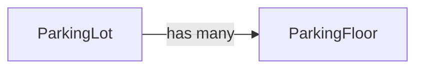
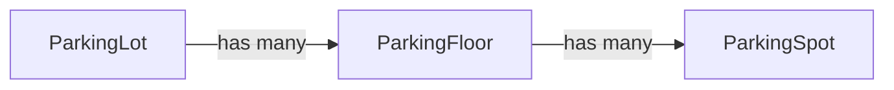
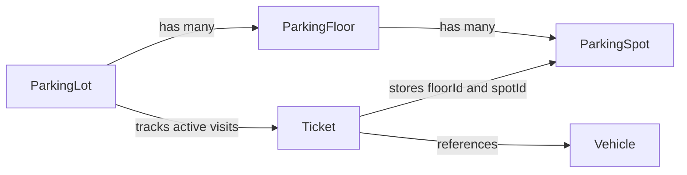
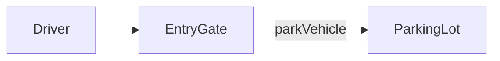
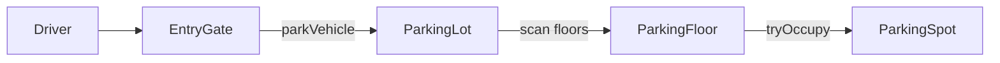
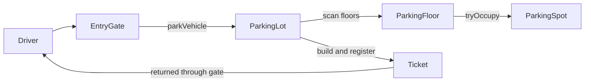

# Parking lot LLD: notes for the linked final Java code

Based on [Shubh Patel's final implementation](https://github.com/shubhkpatel/Low-Level-Design/tree/main/src/main/java/org/nailyourinterview/lld/parking_lot) and [his parking-lot lesson](https://www.youtube.com/watch?v=kzfrbkDcYjA). Reviewed on 29 October 2026. The English auto-generated transcript was successfully retrieved and read alongside all 29 Java files. These are explanatory notes, not a transcript. Design rationale below is an interpretation unless explicitly attributed to the lesson.

This document explains that implementation. The existing `STUDY_GUIDE.md` in this folder teaches a different, progressively built implementation.

## 1. Understand the system as two journeys

A parking lot assigns a compatible free spot to an arriving vehicle and records the visit in a ticket. When the driver leaves, the system uses that ticket to calculate a fee, collect payment, and release the spot.

Remember these two sequences first:

```text
Entry: vehicle → claim spot → create ticket
Exit:  ticket → calculate fee → collect payment → release spot
```

The rest of the design assigns responsibility for those steps to objects.

## 2. Derive requirements before choosing patterns

The lesson groups questions into **extensibility, dynamic configuration, and concurrency**. This is a useful interview checklist, rather than a formal classification you must always follow.

| Category | Requirement in this example | Consequence in the code |
|---|---|---|
| Extensibility | Support bikes, cars, trucks, and potentially new vehicle types | `Vehicle`, subclasses, `VehicleType`, `VehicleFactory` |
| Extensibility | Every spot supports one specific vehicle type | `ParkingSpot.allowedType`; exact enum equality |
| Extensibility | Support time-based and event-based charging | `PricingStrategy` and two implementations |
| Extensibility | Support cash, UPI, and card | `PaymentStrategy` and three implementations |
| Dynamic configuration | Configure multiple floors and spots | `addFloor()` and `addSpot()` |
| Dynamic configuration | Create multiple entry and exit gates | Separate gate objects with IDs |
| Workflow | Issue a ticket at entry and use it at exit | `Ticket` and `activeTickets` |
| Scope | Model one physical lot | Singleton `ParkingLot` in this implementation |
| Concurrency | Two arrivals must not claim the same free spot | `AtomicBoolean.compareAndSet(false, true)` |

Exact matching matters: a bike cannot use a car spot in this code, even if the car spot is empty. There is no size hierarchy or fallback rule.

The lot selects the pricing policy. The driver selects the payment mode. The lesson makes this distinction around [26:44–27:30](https://www.youtube.com/watch?v=kzfrbkDcYjA&t=1604s).

Dynamic configuration here means objects can be added through methods. It does **not** mean concurrent administration is already safe, or that an admin UI exists.

## 3. Build the object model in small steps

First, physical containment:



Then add the thing that is actually allocated:



Now record the visit:



The last diagram is conceptual. A ticket stores location IDs, not a `ParkingSpot` object reference. The spot stores an occupancy flag, not the parked vehicle. The active ticket links the visit, vehicle, and location.

This explains why `Ticket` exists even though we already have `Vehicle`: a vehicle is the thing arriving; a ticket identifies **one visit** by that vehicle.

### Class responsibilities

| Class or interface | What it owns or does | Why it exists |
|---|---|---|
| `ParkingLot` | Floors, active tickets, current pricing strategy; entry and exit coordination | The complete parking workflow needs one coordinator |
| `ParkingFloor` | Map of spots; scans for and claims a compatible spot | Groups physical spots by floor |
| `ParkingSpot` | ID, allowed vehicle type, atomic occupancy flag | Owns whether this particular spot is free |
| `Vehicle` | Number plate and type | Common vehicle data |
| `Bike`, `Car`, `Truck` | Set their respective types through constructors | Concrete vehicle classes; currently no extra behavior |
| `Gate` | Common gate ID and abstract `getType()` | Common parent for the two gate kinds |
| `EntryGate` | Delegates `parkVehicle()` to the lot | Entry-facing interface |
| `ExitGate` | Delegates `unparkVehicle()` to the lot | Exit-facing interface |
| `Ticket` | Ticket ID, entry time, vehicle, floor ID, spot ID, payment status | Records one parking visit |
| `PricingStrategy` | Contract for calculating fees | Separates billing policy from orchestration |
| `PaymentStrategy` | Contract for processing a payment | Separates payment method from orchestration |
| `PaymentProcessor` | Holds a payment strategy and updates ticket payment status | Payment Strategy's context |
| Three factories | Construct a vehicle, pricing policy, or payment policy from an enum | Centralize concrete-class selection |
| `DateTimeParser` | Parses the demonstration's date strings | Demo utility; not central to the design |

`GateType`, `VehicleType`, `PaymentMode`, `PaymentStatus`, and `PricingStrategyType` are enums. Enums define a fixed vocabulary; they are not design patterns.

Source: [models](https://github.com/shubhkpatel/Low-Level-Design/tree/main/src/main/java/org/nailyourinterview/lld/parking_lot/model), [services](https://github.com/shubhkpatel/Low-Level-Design/tree/main/src/main/java/org/nailyourinterview/lld/parking_lot/service).

## 4. Trace entry in the actual code

Start with the boundary:



Then follow allocation:



Finally, return the record of the visit:



The code executes these steps:

1. The caller creates a vehicle, usually through `VehicleFactory.create(number, type)`.
2. `EntryGate.parkVehicle(vehicle, entryTime)` forwards to `ParkingLot.getInstance()`.
3. `ParkingLot.parkVehicle()` iterates through `floors.values()`.
4. Each floor calls `findAvailableSpot(vehicle.getType())`.
5. The floor iterates through its spots and checks:

   ```java
   spot.getAllowedType() == vehicleType && spot.tryOccupy()
   ```

6. `tryOccupy()` atomically changes occupancy from `false` to `true`. If it succeeds, the floor returns that spot.
7. The lot generates a UUID and builds the ticket with the vehicle, location, and entry time.
8. The ticket is inserted into `activeTickets`, keyed by ticket ID.
9. The ticket is returned. If no compatible spot can be claimed, the code prints a message and returns `null`.

**`findAvailableSpot()` is a command as well as a search.** A successful call has already occupied the spot. Calling it just to display availability would change the system. A name such as `tryAllocateSpot()` would communicate this side effect more clearly.

Both floor and spot collections are `HashMap`s. The selected spot is the first successfully claimed compatible spot in their iteration order. It is not guaranteed to be nearest, lowest numbered, or on the lowest floor. There is no allocation Strategy in this final code.

Source: [ParkingLot.java](https://github.com/shubhkpatel/Low-Level-Design/blob/main/src/main/java/org/nailyourinterview/lld/parking_lot/service/ParkingLot.java), [ParkingFloor.java](https://github.com/shubhkpatel/Low-Level-Design/blob/main/src/main/java/org/nailyourinterview/lld/parking_lot/model/ParkingFloor.java).

## 5. Trace exit in the actual code

Read the exit method as three connected operations: identify the visit, settle its bill, and release its location.

```text
ExitGate.unparkVehicle(ticketId, exitTime, paymentMode)
  → ParkingLot.unparkVehicle(...)
      → look up active ticket
      → pricingStrategy.calculateFee(type, entryTime, exitTime)
      → PaymentStrategyFactory.get(paymentMode)
      → new PaymentProcessor(strategy).pay(ticket, fee)
          → strategy.processPayment(ticket, fee)
          → set ticket payment status to SUCCESS or FAILED
      → on success: vacate spot, remove active ticket
```

There are three outcomes:

| Situation | Actual behavior |
|---|---|
| Ticket ID is unknown | Print an invalid-ticket message and return |
| Payment returns `false` | Mark ticket `FAILED`; keep ticket active and spot occupied |
| Payment returns `true` | Mark ticket `SUCCESS`; vacate spot; remove ticket from active map |

All three concrete payment classes currently print a message and return `true`. The failure branch exists but the supplied payment implementations do not exercise it. There is no real card, UPI, or cash reconciliation integration.

After a successful sequential exit, a second exit with the same ticket ID is rejected because the ticket is no longer active. This does not prevent two concurrent exits from reading the ticket before either removes it.

Source: [ParkingLot.java](https://github.com/shubhkpatel/Low-Level-Design/blob/main/src/main/java/org/nailyourinterview/lld/parking_lot/service/ParkingLot.java), [PaymentProcessor.java](https://github.com/shubhkpatel/Low-Level-Design/blob/main/src/main/java/org/nailyourinterview/lld/parking_lot/service/PaymentProcessor.java).

## 6. Strategy pattern: used in two independent places

Use Strategy when a workflow stays the same but an algorithm inside it can vary. The caller holds an interface and delegates the variable step to an implementation.

### A. Pricing Strategy

| Pattern role | Class in this code |
|---|---|
| Strategy interface | `PricingStrategy` |
| Concrete strategies | `TimeBasedPricing`, `EventBasedPricing` |
| Context holding and using the strategy | `ParkingLot` |
| Strategy operation | `calculateFee(VehicleType, LocalDateTime, LocalDateTime)` |

The lot always asks for a fee using the same method. The object behind `pricingStrategy` decides how to calculate it.

```java
lot.setPricingStrategy(
    PricingStrategyFactory.get(PricingStrategyType.EVENT_BASED)
);
```

Selecting a different implementation changes billing without changing the body of `unparkVehicle()`.

Interview explanation: **“The exit workflow needs a fee, but it should not contain every billing algorithm. I delegate that calculation to `PricingStrategy`.”**

The global strategy is consulted at exit. The ticket does not preserve a pricing policy or tariff version. Changing the strategy while a vehicle is parked can change the bill for that existing visit. Whether this is acceptable is a requirement to clarify.

### B. Payment Strategy

| Pattern role | Class in this code |
|---|---|
| Strategy interface | `PaymentStrategy` |
| Concrete strategies | `CashPayment`, `UpiPayment`, `CardPayment` |
| Context | `PaymentProcessor` |
| Strategy operation | `processPayment(Ticket, double)` |

`PaymentProcessor` receives its strategy through its constructor. Its `pay()` method delegates payment and handles the common status update.

```java
PaymentStrategy strategy = PaymentStrategyFactory.get(paymentMode);
PaymentProcessor processor = new PaymentProcessor(strategy);
boolean paid = processor.pay(ticket, fee);
```

Interview explanation: **“The driver can choose different payment methods. Each method implements one contract, while the processor handles the common payment result.”**

Constructor injection here is ordinary dependency injection. It does not require Spring or another framework.

Pricing answers **how much**; payment answers **how to collect it**. These are independent choices. Event pricing can work with either UPI or cash without creating classes such as `EventUpiParkingLot`.

Source: [pricing strategies](https://github.com/shubhkpatel/Low-Level-Design/tree/main/src/main/java/org/nailyourinterview/lld/parking_lot/strategy/pricing), [payment strategies](https://github.com/shubhkpatel/Low-Level-Design/tree/main/src/main/java/org/nailyourinterview/lld/parking_lot/strategy/payment). The lesson derives these variation points around [16:13–17:40](https://www.youtube.com/watch?v=kzfrbkDcYjA&t=973s).

## 7. Factory: used in three places

A factory centralizes the decision about which concrete object to create.

| Factory | Input | Returned interface/base class | Possible concrete result |
|---|---|---|---|
| `VehicleFactory.create()` | Number plate, `VehicleType` | `Vehicle` | `Bike`, `Car`, `Truck` |
| `PricingStrategyFactory.get()` | `PricingStrategyType` | `PricingStrategy` | `TimeBasedPricing`, `EventBasedPricing` |
| `PaymentStrategyFactory.get()` | `PaymentMode` | `PaymentStrategy` | `CashPayment`, `UpiPayment`, `CardPayment` |

Each uses a static method with a switch expression. These are **simple factories**, also called static factories. They are not the subclass-overridden GoF Factory Method pattern, and they do not form an Abstract Factory for product families.

Why pair Factory with Strategy?

```text
Factory:  given UPI, construct a UpiPayment object.
Strategy: use that object through processPayment().
```

Creation and execution solve different problems. A Strategy does not require a factory: a caller could directly inject `new UpiPayment()`. The factories are useful here because callers select implementations through enums.

Adding a new policy preserves the existing exit workflow, but you must still update the enum and factory switch. Do not claim that adding a type changes no existing files. Adding a vehicle may also require updating pricing switches and rate maps.

Source: [factory package](https://github.com/shubhkpatel/Low-Level-Design/tree/main/src/main/java/org/nailyourinterview/lld/parking_lot/factory). The lesson discusses vehicle creation around [23:08](https://www.youtube.com/watch?v=kzfrbkDcYjA&t=1388s) and policy factories around [40:58–42:25](https://www.youtube.com/watch?v=kzfrbkDcYjA&t=2458s).

## 8. Singleton: `ParkingLot`

The implementation uses an eager Singleton:

```java
private static final ParkingLot INSTANCE = new ParkingLot();

private ParkingLot() {
    this.pricingStrategy = PricingStrategyFactory.get(
        PricingStrategyType.TIME_BASED
    );
}

public static ParkingLot getInstance() {
    return INSTANCE;
}
```

The private constructor restricts normal construction, and the accessor gives gates the shared service instance. Java initializes the static instance when the class is initialized. More precisely, this supplies an instance per defining class loader, not one shared instance across servers.

The teaching rationale is the one-physical-lot assumption. That assumption makes Singleton a possible implementation choice; it does not make Singleton mandatory. An application can construct one ordinary lot and pass it to both gates.

Tradeoffs worth explaining:

- Gates have a hidden dependency on global state through `getInstance()`.
- Tests share the same maps unless they are reset or isolated.
- Supporting several lots requires changing the construction and lookup model.
- Safe instance initialization does not make the instance's mutable fields thread-safe.

For multiple lots, give each lot its own identity and state. A registry or manager can map lot IDs to lot objects, and a gate can refer to its associated lot. A manager does not have to be a Singleton.

Source: [ParkingLot.java](https://github.com/shubhkpatel/Low-Level-Design/blob/main/src/main/java/org/nailyourinterview/lld/parking_lot/service/ParkingLot.java). See [27:30–28:44](https://www.youtube.com/watch?v=kzfrbkDcYjA&t=1650s) for the lesson's proposed multi-lot extension.

## 9. Builder: `Ticket`

`Ticket` uses Lombok's `@Builder`, and the lot constructs it with named fields:

```java
Ticket ticket = Ticket.builder()
    .ticketId(ticketId)
    .entryTime(entryTime)
    .vehicle(vehicle)
    .floorId(floor.getId())
    .spotId(spot.getId())
    .build();
```

This makes a group of arguments easier to read than several positional strings in a constructor. Lombok generates the builder implementation.

Builder improves construction syntax. It does not automatically make a ticket immutable, validate its required fields, or prevent illegal combinations. This ticket also has `@Data`, so its fields have generated setters.

**Actual default-value issue:** the source initializes `paymentStatus` to `PENDING`, but does not annotate that field with `@Builder.Default` or pass the status to the builder. Under Lombok's documented builder behavior, this creation path produces `null` for that omitted reference field. The lesson describes the intended initial state as pending; the final code does not reliably express that intention through its builder.

A focused correction would be either `@Builder.Default` on the initialized field or `.paymentStatus(PaymentStatus.PENDING)` in the builder call. These notes identify the issue without changing the linked code.

Source: [Ticket.java](https://github.com/shubhkpatel/Low-Level-Design/blob/main/src/main/java/org/nailyourinterview/lld/parking_lot/model/Ticket.java), [Lombok builder defaults](https://projectlombok.org/features/Builder). The lesson discusses Builder around [58:14–58:58](https://www.youtube.com/watch?v=kzfrbkDcYjA&t=3494s).

## 10. Relationships that are not additional patterns

| Relationship or technique | Where | Accurate description |
|---|---|---|
| Inheritance | `Bike extends Vehicle`, `EntryGate extends Gate` | An is-a relationship |
| Object containment | Lot has floors; floor has spots | A has-a relationship |
| Delegation | Gate forwards a request to the lot | Thin entry/exit boundary, described as controller-like in the lesson |
| Interface-based polymorphism | Different pricing/payment implementations | The execution mechanism used by Strategy |
| Dependency injection | `PaymentProcessor(PaymentStrategy)` | Constructor supplies a dependency |
| Atomic compare-and-set | Spot occupancy | A concurrency primitive |

Do not call the vehicle hierarchy Template Method: there is no base-class algorithm with overridable steps. Do not call `printStatus()` Observer: it reads current state directly and does not receive notifications. Payment status enums do not establish the State pattern. There is no Decorator, allocation Strategy, or payment-gateway Adapter implemented here.

`ParkingLot` provides a facade-like high-level API, but its central role here is workflow coordination. The strongest named-pattern answer is the two Strategies, three simple factories, Singleton, and Builder.

## 11. Pricing: calculate what this code actually charges

Both policies convert elapsed time to whole minutes, divide by 60.0, and round upward to a number of billable hours.

### Event pricing

| Vehicle | Event rate per hour |
|---|---:|
| Bike | ₹30 |
| Car | ₹50 |
| Truck | ₹70 |

`fee = roundedHours × eventHourlyRate`.

Despite its name, `EventBasedPricing` does not detect New Year or query an event calendar. Someone selects this policy for the lot. It then uses its fixed hourly rate map.

### Time-based pricing

| Vehicle | Peak rate per hour | Non-peak rate per hour |
|---|---:|---:|
| Bike | ₹15 | ₹10 |
| Car | ₹30 | ₹20 |
| Truck | ₹50 | ₹30 |

The algorithm truncates entry time to the start of its clock hour. It then inspects `roundedHours` successive hour starts. A sampled time from 08:00 through 17:00, inclusive, counts as peak.

For a car entering at **07:30** and leaving at **13:15**:

```text
Duration       = 345 minutes
Billable hours = ceil(345 / 60.0) = 6
Sampled hours  = 07:00, 08:00, 09:00, 10:00, 11:00, 12:00
Non-peak       = 1 hour
Peak           = 5 hours
Time-based fee = 1 × ₹20 + 5 × ₹30 = ₹170
Event fee      = 6 × ₹50 = ₹300
```

These amounts match the demonstration around [36:34–37:34](https://www.youtube.com/watch?v=kzfrbkDcYjA&t=2194s).

Clarify the billing rule before copying the implementation:

- It prices rounded elapsed hours using samples anchored to the truncated entry hour. It does not partition the exact stay into peak and non-peak minute intervals.
- For 07:30–08:30, it bills one hour sampled at 07:00. Crossing into peak time does not itself add a peak charge.
- Since 17:00 is included, a sample at 17:00 makes that entire charged unit peak. If the intended peak interval is 08:00–17:00 with an exclusive end, this is a mismatch.
- Conversion to whole minutes discards seconds. A positive stay shorter than one minute is billed as zero hours. A stay of 60 minutes and one second is treated as 60 minutes.
- Zero duration produces zero charge. There is no one-hour minimum.
- Time-based pricing rejects an exit before entry. Event-based pricing does not perform the same validation and can yield a negative charge for sufficiently negative durations.

These are interview follow-ups about requirements and correctness, not reasons to memorize a more elaborate billing engine.

Source: [TimeBasedPricing.java](https://github.com/shubhkpatel/Low-Level-Design/blob/main/src/main/java/org/nailyourinterview/lld/parking_lot/strategy/pricing/TimeBasedPricing.java), [EventBasedPricing.java](https://github.com/shubhkpatel/Low-Level-Design/blob/main/src/main/java/org/nailyourinterview/lld/parking_lot/strategy/pricing/EventBasedPricing.java).

## 12. Concurrency: why `compareAndSet` matters

This naive operation contains a race:

```java
if (!occupied) {
    occupied = true;
    return true;
}
```

Both threads can read `false` before either writes `true`. Both then think they acquired the spot. A `volatile boolean` alone does not combine the check and update into one atomic operation.

The actual code does:

```java
return occupied.compareAndSet(false, true);
```

This means: change the value to `true` only if its current value is `false`, as one atomic operation. The method returns whether this claim succeeded.

| Step | Thread A | Thread B | Spot value |
|---|---|---|---|
| Initially | Ready to claim | Ready to claim | `false` |
| First successful claim | CAS succeeds | Has not claimed yet | `true` |
| Competing claim | Owns this allocation | CAS fails because current value is `true` | `true` |

Either thread can win. Before the spot is vacated again, only one can successfully make that transition. No separate initial read is required.

The floor continues scanning after an unsuccessful claim. If there is no other compatible spot, that arrival fails. The active `Main.java` demonstrates two bikes competing for one bike spot; it does not execute the commented-out exit example. The winner and log order are nondeterministic.

The lesson compares this with synchronizing the whole lot's entry method. A lot-wide lock serializes unrelated arrivals too. A per-spot atomic claim narrows the contested operation. Do not generalize this into “atomics are always faster than locks.” Choosing a lock's scope and protecting the full invariant matter more than a blanket ranking.

Source: [ParkingSpot.java](https://github.com/shubhkpatel/Low-Level-Design/blob/main/src/main/java/org/nailyourinterview/lld/parking_lot/model/ParkingSpot.java), [AtomicBoolean API](https://docs.oracle.com/en/java/javase/21/docs/api/java.base/java/util/concurrent/atomic/AtomicBoolean.html). Video discussion: [45:35–50:35](https://www.youtube.com/watch?v=kzfrbkDcYjA&t=2735s).

## 13. What the atomic claim does not solve

The narrow spot claim is useful. The entire implementation is not consequently thread-safe.

| Issue | Why it exists in this code | Direction for an interview extension |
|---|---|---|
| Concurrent ticket-map updates | `activeTickets` is a mutable `HashMap` | Use appropriate concurrent storage or a shared synchronization policy |
| Two exits charge the same visit | Both can read an active ticket before either removes it | Atomically claim the ticket for checkout before calling payment |
| A stale exit frees a reused spot | An older duplicate exit can call unconditional `vacate()` after reallocation | Make release conditional on the owning visit and serialize checkout |
| Spot claim and ticket registration are separate | Allocation succeeds before the active ticket is registered | Define rollback and an allocation/registration boundary |
| Same vehicle can park twice | No active-plate index or uniqueness check | Add an atomic per-vehicle admission rule if required |
| Runtime changes to floors/spots | Maps are mutable and exposed through generated getters | Define configuration lifecycle and encapsulate mutation |
| Pricing changes during visits | One mutable policy reference is consulted on exit | Define when tariffs become binding and preserve a version if needed |

Java's `HashMap` is unsynchronized and has no iteration-order guarantee. Read-only floor/spot maps configured before worker threads start are a different case from maps modified concurrently. The ticket map changes as part of normal runtime operation. [HashMap documentation](https://docs.oracle.com/en/java/javase/21/docs/api/java.base/java/util/HashMap.html).

Replacing a map with `ConcurrentHashMap` protects map operations. It does not make a sequence such as lookup → charge → release → remove atomic, or make the mutable objects inside the map thread-safe.

This also qualifies the video's multi-lot discussion around [28:44–30:55](https://www.youtube.com/watch?v=kzfrbkDcYjA&t=1724s): a concurrent registry of lots does not by itself protect each lot's internals. Reading a map value gives callers the stored object reference, not an independent copy of the lot. Its shared mutable state needs its own concurrency design.

A stronger checkout model might track `ACTIVE → PAYING → CLOSED`, with defined recovery for declined or unresolved payments. That would be an extension, not a State-pattern implementation already present in this repository. For remote payments, add provider idempotency and avoid holding a broad lot lock during the network call.

Interview wording: **“The atomic flag prevents competing claims on one currently free spot. I would separately protect the ticket registry and the payment/exit lifecycle before calling the whole service thread-safe.”**

## 14. SOLID: explain concrete evidence and limits

| Principle | Evidence here | Qualification |
|---|---|---|
| Single responsibility | Fees live in pricing classes; method-specific payment behavior lives in payment classes | `ParkingLot` still combines allocation orchestration, ticket storage, output, and checkout |
| Open/closed | New strategy implementations can preserve the existing exit algorithm | Enum and factory selection still require edits; vehicle additions also affect rates |
| Liskov substitution | The three vehicles can be passed through the `Vehicle` base type | The hierarchy has little behavior, so it is a limited illustration |
| Interface segregation | Pricing and payment have separate small contracts | Avoid claiming every small interface automatically proves a complete design |
| Dependency inversion | Lot/processor delegate policy work through interfaces | Gates still directly access a concrete global lot, and the lot calls concrete factories |

SOLID is a way to assess responsibilities and dependencies. Naming every letter is less useful than explaining one actual change and which callers remain stable.

The vehicle subclasses currently only select enum values. For this behavior alone, a single vehicle data class with a type could be enough. Keep the hierarchy when the interview expects distinct vehicle behavior or data; explain the tradeoff rather than assuming every noun needs subclasses.

## 15. Data structures and complexity

Let `S` be the total number of configured spots, `F` the number of floors, `T` the number of active tickets, and `H` the number of rounded billable hours.

| Operation | Cost under ordinary map sizing |
|---|---|
| Find and claim a spot | O(F + S) worst-case scan |
| Active ticket lookup | Expected O(1) |
| Event fee calculation | O(1) |
| Time-based fee calculation | O(H), due to the hourly loop |
| Exit lookup, location lookup, removal | Expected O(1), excluding pricing and payment |
| Print all spot statuses | O(F + S) |
| Stored domain data | O(F + S + T) |

These are algorithmic estimates, not benchmark results. HashMap iteration also depends on backing-table capacity. Map lookup makes release by stored IDs efficient; it does not make the allocation scan constant time.

If allocation must scale or become nearest-first, a per-type availability index or an allocation policy can be introduced. Define the selection requirement before choosing a heap, sorted set, queue, or scan.

## 16. Reconstruct the design in an interview

Use this order instead of recalling the repository's folder order:

1. **Tell the two journeys.** Arrive → claim → ticket. Present ticket → fee → pay → release.
2. **Clarify the rules.** Vehicle types, compatibility, floors/gates, pricing, payment choices, and simultaneous arrivals.
3. **Draw physical structure.** Lot → floors → spots.
4. **Record a visit.** Add ticket identity, vehicle, entry time, and allocated location.
5. **Assign coordination.** Gates delegate; the lot coordinates; the spot owns its claim operation.
6. **Find what varies.** Fee calculation and payment method become separate Strategy interfaces.
7. **Explain selection and construction.** Enum-driven simple factories create concrete implementations. Builder names ticket fields.
8. **Protect invariants.** First prevent two claims on a free spot. Then discuss ticket registration and duplicate checkout.
9. **Walk one normal case and one conflict.** Use the ₹170/₹300 example and two bikes competing for one bike spot.
10. **State tradeoffs.** Singleton is a choice; current maps and checkout do not provide full concurrency safety.

For a 40-minute discussion, a reasonable practice allocation is: 5 minutes for requirements, 7 for objects and relationships, 13 for core entry/exit code, 8 for policies and concurrency, and 7 for edge cases and follow-ups. Adjust to the interviewer's scope.

### A short spoken explanation

> I model one parking lot containing floors, with typed spots on each floor. Entry gates delegate to the lot, which scans for a compatible spot and atomically claims it. It returns a ticket identifying the visit and location. At exit, the lot looks up the ticket and delegates fee calculation to a pricing strategy. The selected payment mode creates a payment strategy, which a payment processor executes. Successful payment releases the spot and removes the active ticket. The factories centralize concrete-class selection, and the ticket uses a builder. The lot is an eager Singleton in this example. Its atomic spot claim handles competing arrivals, but ticket storage and duplicate checkout need additional protection.

## 17. Memorize decisions and invariants

Remember five verbs: **claim, record, price, pay, release**.

For each verb, recall its owner:

```text
Claim   → ParkingFloor finds; ParkingSpot atomically claims
Record  → ParkingLot builds and registers Ticket
Price   → PricingStrategy
Pay     → PaymentProcessor delegates to PaymentStrategy
Release → ParkingLot locates the spot and invokes vacate
```

Then recall the pattern from the question it answers:

| Question | Answer |
|---|---|
| Which billing/payment algorithm executes? | Strategy |
| Which concrete object should be constructed? | Simple Factory |
| How is the shared lot obtained in this example? | Singleton |
| How are many ticket fields assembled readably? | Builder |
| How do competing arrivals claim one free spot? | Atomic compare-and-set, a concurrency primitive |

Remember the intended invariants too:

- One currently free spot must not be allocated to two simultaneous arrivals.
- Only a compatible vehicle should claim a spot.
- A successful entry should have an active ticket identifying its allocation.
- Failed payment must not release the spot.
- A completed visit should not be charged or released again.

The last two show why concurrency must cover a workflow, not just a boolean. The current code does not fully enforce every invariant under failure or concurrent exit.

Practice from a blank page: draw the objects, trace entry, trace exit, then place the patterns where the requirements make behavior vary. Review after one day, a few days, and a week. Use recall rather than repeatedly rereading code. You do not need to memorize Lombok annotations or reproduce the exact hourly loop to explain the design well.

## 18. Common follow-up questions

**Why have both a factory and Strategy?** The factory chooses and creates an object. Strategy lets the workflow execute its behavior through a stable contract.

**Why does the gate not contain billing logic?** Gates are boundaries. Keeping shared coordination in the lot avoids duplicating the workflow across multiple gates.

**Why store floor and spot IDs on a ticket?** Exit can locate the allocation directly instead of scanning the lot. A ticket also captures the entry time needed for billing.

**What happens when the lot is full?** Allocation scans for a compatible free spot. If none can be claimed, it prints a message and returns `null`. Other vehicle types may still have free spots.

**What happens if payment fails?** The processor marks the ticket failed; the lot keeps it active and retains occupancy. The supplied payment stubs always succeed.

**Can two gates double-book a spot?** Competing `compareAndSet(false, true)` calls cannot both claim the same free interval. The rest of the admission workflow still needs coordination and consistent registration.

**Does Singleton provide thread safety?** It provides shared access and safe static construction. It does not synchronize all methods or maps.

**Would a concurrent map solve checkout?** No. Individual map operations and the multi-step payment lifecycle are different synchronization problems.

**How do you add a bus?** In this implementation, update the enum, add a subclass and factory branch, define rates in both pricing policies, and configure compatible spots. Check every switch and rate table.

**How do you add nearest-spot allocation?** Define what distance means and whether it depends on entry gate. Add an allocation policy/index appropriate to that rule; the current gate ID is not used in spot selection.

**How do you support several lots?** Construct independent lot objects, associate gates with lot IDs, and look up the selected lot through a registry. A concurrent registry does not synchronize each lot's business operations.

**What would you improve first?** Correct the ticket default, define billing boundaries, protect active ticket mutations, and serialize/idempotently identify checkout for each visit. Add persistence and payment integration when those requirements enter scope.

## 19. Video review map

These timestamps come from the video's chapter metadata and the retrieved auto-generated transcript. Small spoken-time offsets are normal.

| Review goal | Jump to |
|---|---|
| Interview process: understand, requirements, entities, flow, code | [00:18](https://www.youtube.com/watch?v=kzfrbkDcYjA&t=18s) |
| Parking-lot requirements | [07:45](https://www.youtube.com/watch?v=kzfrbkDcYjA&t=465s) |
| Derive entities and the two Strategies | [15:15](https://www.youtube.com/watch?v=kzfrbkDcYjA&t=915s) |
| Class diagram and responsibilities | [19:00](https://www.youtube.com/watch?v=kzfrbkDcYjA&t=1140s) |
| Lot, floors, spots, and shared instance | [23:55](https://www.youtube.com/watch?v=kzfrbkDcYjA&t=1435s) |
| Multiple-lot extension; read the qualification in section 13 | [27:52](https://www.youtube.com/watch?v=kzfrbkDcYjA&t=1672s) |
| Entry and exit flow | [31:38](https://www.youtube.com/watch?v=kzfrbkDcYjA&t=1898s) |
| Code output: fee example and competing bikes | [34:00](https://www.youtube.com/watch?v=kzfrbkDcYjA&t=2040s) |
| Enums, factories, vehicles, gates | [39:08](https://www.youtube.com/watch?v=kzfrbkDcYjA&t=2348s) |
| Atomic occupancy and comparison with a broad lock | [45:35](https://www.youtube.com/watch?v=kzfrbkDcYjA&t=2735s) |
| Pricing and payment implementations | [50:35](https://www.youtube.com/watch?v=kzfrbkDcYjA&t=3035s) |
| ParkingLot orchestration and Ticket Builder | [55:57](https://www.youtube.com/watch?v=kzfrbkDcYjA&t=3357s) |

## 20. Read the repository in execution order

1. [Main.java](https://github.com/shubhkpatel/Low-Level-Design/blob/main/src/main/java/org/nailyourinterview/lld/parking_lot/Main.java): setup and active two-bike demonstration.
2. [EntryGate.java](https://github.com/shubhkpatel/Low-Level-Design/blob/main/src/main/java/org/nailyourinterview/lld/parking_lot/model/EntryGate.java): boundary delegation.
3. [ParkingLot.java](https://github.com/shubhkpatel/Low-Level-Design/blob/main/src/main/java/org/nailyourinterview/lld/parking_lot/service/ParkingLot.java): follow `parkVehicle()` first.
4. [ParkingFloor.java](https://github.com/shubhkpatel/Low-Level-Design/blob/main/src/main/java/org/nailyourinterview/lld/parking_lot/model/ParkingFloor.java) and [ParkingSpot.java](https://github.com/shubhkpatel/Low-Level-Design/blob/main/src/main/java/org/nailyourinterview/lld/parking_lot/model/ParkingSpot.java): follow allocation and its atomic step.
5. [Ticket.java](https://github.com/shubhkpatel/Low-Level-Design/blob/main/src/main/java/org/nailyourinterview/lld/parking_lot/model/Ticket.java): understand the visit record.
6. Return to `ParkingLot.unparkVehicle()`, then open the [pricing](https://github.com/shubhkpatel/Low-Level-Design/tree/main/src/main/java/org/nailyourinterview/lld/parking_lot/strategy/pricing) implementations.
7. Read [PaymentStrategyFactory.java](https://github.com/shubhkpatel/Low-Level-Design/blob/main/src/main/java/org/nailyourinterview/lld/parking_lot/factory/PaymentStrategyFactory.java), [PaymentProcessor.java](https://github.com/shubhkpatel/Low-Level-Design/blob/main/src/main/java/org/nailyourinterview/lld/parking_lot/service/PaymentProcessor.java), and the [payment implementations](https://github.com/shubhkpatel/Low-Level-Design/tree/main/src/main/java/org/nailyourinterview/lld/parking_lot/strategy/payment).
8. Finish with enums, the other factories, and vehicle/gate inheritance. These supply vocabulary and construction details for the flows you now understand.

Verification basis: source tracing against the linked final files, the successfully retrieved video transcript, and official Java/Lombok documentation. The remote Java project was not compiled or executed as part of these notes.
