# Parking lot LLD: build the design one requirement at a time

**A guided study document · Java 17+ · four runnable checkpoints · UML, dry runs and exercises**

The goal is to learn how to arrive at a design you can explain. At each checkpoint, read the problem, pause at the question, inspect the diagram, and then read the implementation. Try predicting which existing class must change before moving on.

**About your video.** Your reference is [“6. Parking Lot, Low Level Design (Hindi)” by Concept && Coding — Shrayansh](https://www.youtube.com/watch?v=MtjZf7291zc). When checked on 28 October 2026, YouTube returned a members-only playback restriction and no accessible transcript. Its description links to an [English version and completed implementation](https://www.youtube.com/watch?v=g8AVGr_0Wko). I could verify that metadata, but not the lesson's spoken explanation or diagrams. This guide is therefore an original walkthrough of the same problem, not a transcript, timestamped companion, or claim about the instructor's exact design. The extra failure-handling material is part of this guide's own design.

## Study route

| Stop | Question you should be able to answer | New idea |
|---|---|---|
| 0. Requirements | What does “park a vehicle” promise? | Scope and invariants |
| 1. Basic allocation | Which objects must exist to park and release a car? | Objects and ownership |
| 2. Tickets and billing | How do we identify a particular visit? | Visit identity and immutable facts |
| 3. Variable policies | What changes when “first available” becomes “nearest”? | Strategy and composition |
| 4. Payments and multiple gates | What must remain true when requests fail or overlap? | State, idempotency and atomic operations |
| Extensions | Which requirement would justify another class? | Floors, factories, displays and persistence |

You can stop at checkpoint 2 for a small object-model exercise, checkpoint 3 for a design-pattern discussion, or checkpoint 4 for an interview that includes payments and concurrency. These are progressively richer scopes, not a ranking of programmers.

## 0. Establish the rules before drawing classes

Imagine a driver arriving, receiving a spot and a ticket, staying for some time, paying, and leaving. That story gives you a workflow; it does not yet tell you whether the system supports bikes, reservations, multiple floors or cash payments.

An effective interview opening is: “I'll start with one lot, bikes and cars, one spot per vehicle, ticket-based entry, and hourly fees. I'll then add configurable allocation, payment outcomes, and concurrent gates.” Give the interviewer room to adjust those assumptions.

### Questions that actually affect the design

| Clarification | Assumption used here | Why it matters |
|---|---|---|
| Which vehicles? | Bikes and cars | Compatibility and rates |
| Can a bike use a car spot? | No; exact type matching | Avoids an unstated fallback rule |
| How many floors? | One; floors are a later extension | No need for a floor class initially |
| Which spot gets assigned? | First available, later nearest to a fixed reference entrance | Creates the allocation-policy variation |
| How are fees calculated? | INR 20/hour for bikes, INR 50/hour for cars; each started hour, minimum one hour | Makes rounding and zero-duration behavior explicit |
| When is the fee fixed? | Checkpoints 2–3: exit time. Checkpoint 4: first payment request | Payment retries must use a stable amount |
| What does payment failure mean? | Definitive decline differs from an unknown result | Determines whether a new attempt is safe |
| When is a spot released? | Checkpoint 4: successful payment followed by logical exit confirmation | Paying alone does not make the space available |
| What about physical barriers? | An adapter can invoke the service; motor control and sensors are outside the code | Physical departure needs additional state in a real installation |
| Where is data stored? | In memory, one Java process | A Java lock cannot protect multiple application instances |

Reservations, monthly passes, lost-ticket penalties, EV charging, administrative screens and multiple payment methods are follow-up requirements. Do not implement them before the interviewer asks.

### Write invariants, not just features

An invariant is a condition that must hold after every completed operation:

1. A spot has at most one current parking session.
2. A normalized plate has at most one current parking session.
3. An assigned spot accepts the vehicle's type.
4. A ticket identifies one visit, even if the same vehicle visits again later.
5. In checkpoint 4, unpaid or unresolved payment cannot release the spot.
6. Repeating a completed payment or exit does not charge or release again.
7. A rejected request leaves the existing allocation intact.

The first three prevent incorrect entry. The next three protect the visit lifecycle. The last one tells you to validate before changing shared state.

### UML: the behavior before the classes

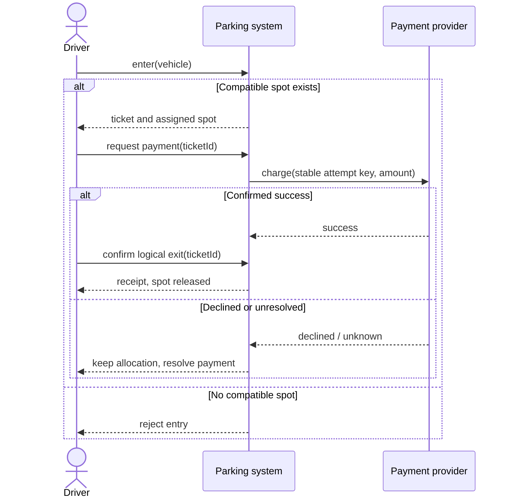

**Pause and answer:** If there are ten empty bike spots and zero empty car spots, is the lot full? For a car, yes. “Full” is relative to compatibility, not just total occupancy.

## 1. Checkpoint one: the smallest useful object model

**Requirement:** Park a compatible vehicle in an available spot; release it when it leaves. We temporarily identify departures by plate and assume one thread.

### Derive the objects

Start with nouns, then ask whether each noun needs identity or behavior.

| Candidate | Keep it? | Reason |
|---|---|---|
| Vehicle | Yes | Plate and type travel together |
| Parking spot | Yes | Has identity, compatibility and occupancy |
| Parking lot | Yes | Coordinates the collection of spots |
| Driver | Not yet | No driver-specific rule or data is required |
| Car and Bike subclasses | Not yet | Their only distinction is a type value |
| Entrance gate | Not yet | No independent gate behavior in this checkpoint |

`VehicleType` is an enum because we have a small, explicit set of categories. `Vehicle` is a record because its facts do not change during a visit. `ParkingSpot` is mutable because its occupant changes. `ParkingLot` coordinates the operation because assigning one spot requires looking across multiple spots.

“A lot has spots” is composition. “A spot currently holds a vehicle” is an association; the vehicle still exists when it leaves the lot.

### UML: three meaningful objects

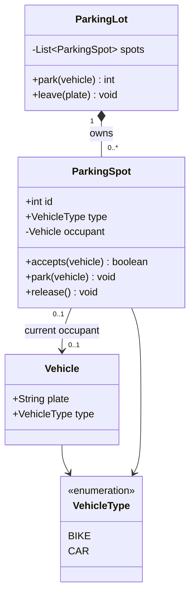

**UML reading key:** `*--` means ownership/composition, `-->` means an association/reference, `..>` means a dependency, and `..|>` means a class implements an interface. `0..1` means optional; `0..*` means any number. Class diagrams show the important domain types, not every Java library class or test helper. UML operations are conceptually public API; nested demo classes use package access to keep the files short.

### Walk through the operation

1. Normalize the plate: trim surrounding spaces and uppercase it with `Locale.ROOT`.
2. Reject the vehicle if that normalized plate is already parked.
3. Scan for the first empty spot of the same type.
4. Ask the spot to occupy itself; it checks its own availability and compatibility.
5. Return the spot's ID.

Do not store both `isEmpty` and `occupant` unless you have a good reason. If `isEmpty == true` while `occupant != null`, which value should a caller believe? Here, `occupant == null` answers the question directly.

### Runnable code

The complete implementation is [BasicParkingDemo.java](checkpoint1/BasicParkingDemo.java). All types are nested in one executable class for convenience; nesting is not a domain requirement.

<!-- code: checkpoint1/BasicParkingDemo.java -->

### Dry run

| Action | Bike spot 1 | Car spot 2 | Result |
|---|---|---|---|
| Start | Empty | Empty | Two available spots |
| Park car A | Empty | A | Return spot 2 |
| Park car A again | Empty | A | Reject duplicate plate |
| Park car B | Empty | A | Reject: no car spot |
| A leaves | Empty | Empty | Spot 2 reusable |

### Why stop here before adding more?

This design already solves allocation. Its limitations now give us concrete reasons to extend it: there is no entry time, no bill, and no separate identity for today's visit versus tomorrow's. Passing only a plate into `leave()` cannot identify a historical visit.

**Checkpoint question:** Would you fix this by adding `entryTime` to `Vehicle`? That would make the vehicle describe a visit. A car exists before and after each visit, so the visit needs its own object.

## 2. Checkpoint two: a ticket identifies a visit

**New requirement:** Record entry time, compute a fee on departure, and handle a repeated exit request safely. Payment processing is still outside this version; its exit operation treats fee settlement as external.

### The design change

Add an immutable `Ticket` containing a unique ID, the vehicle, assigned spot ID and entry timestamp. Add a `Receipt` for the completed visit. A plate identifies a vehicle; a ticket ID identifies one stay.

Keep these indexes inside `ParkingLot`:

- `active`: ticket ID → ticket, for active visits.
- `byPlate`: normalized plate → ticket ID, for duplicate-entry checks.
- `closed`: ticket ID → original receipt, for repeated exits.

The spot now holds the current ticket ID instead of the vehicle. The ticket provides the vehicle facts. That makes the occupancy relationship explicitly about a visit.

### UML: preserve the visit after the car leaves

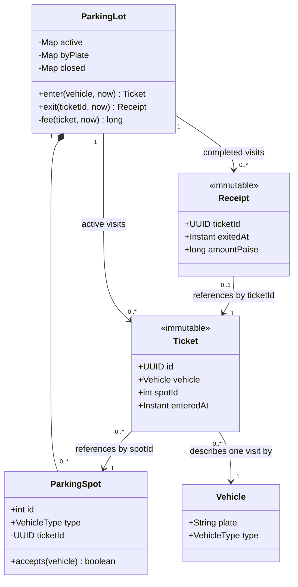

The `0..*` tickets per spot refer to visits over time, not simultaneous occupancy. The current-occupancy invariant still limits a spot to one active ticket.

### Billing must be a precise rule

For a nonnegative stay:

`billableHours = max(1, ceil(elapsedDuration / 1 hour))`

`amountPaise = billableHours × hourlyRatePaise`

| Car's stay | Billable hours | Charge |
|---|---:|---:|
| Zero duration | 1 | INR 50 |
| 59 minutes | 1 | INR 50 |
| Exactly 60 minutes | 1 | INR 50 |
| 60 minutes + 1 nanosecond | 2 | INR 100 |
| 90 minutes | 2 | INR 100 |

The minimum one hour is a business assumption, not a mathematical necessity. You could agree on a free grace period instead, but you must change the rule and its tests together.

The code uses `Duration`, counts complete hours, and checks whether any remainder exists. Truncating to minutes before rounding would incorrectly bill 60 minutes plus one second as one hour. Money is a `long` number of paise; `5000` means INR 50. A multi-currency system would also need currency identity. `Math.multiplyExact` detects overflow instead of silently wrapping.

`Instant` represents a moment; a displayed local time is a presentation concern. The examples pass time in so tests are deterministic. A deployed entry adapter should obtain time from a trusted server clock, not accept an arbitrary timestamp supplied by a driver.

### UML: exit and a repeated request

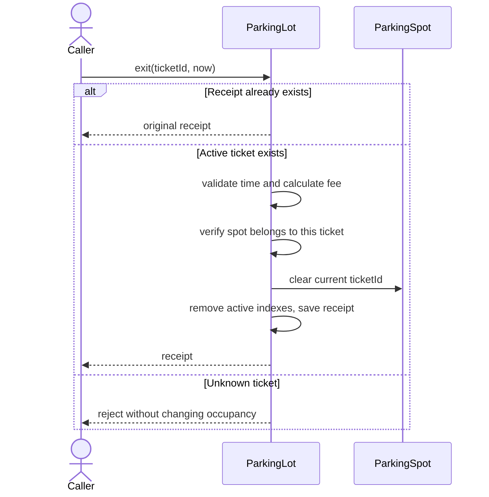

### Runnable code

<!-- code: checkpoint2/TicketParkingDemo.java -->

### Dry run: same vehicle, different visits

At 10:00, car A enters and receives ticket T1. At 11:00:01, it exits with an INR 100 receipt. Repeating `exit(T1)` returns that receipt; it does not repeat the release. At 12:00, the same car receives ticket T2. A late retry using T1 still returns T1's receipt and cannot free T2's spot.

This is **idempotency**: repeating the same logical operation has the same observable result. Another valid API could reject a repeated exit, but returning the original receipt is convenient when a caller retries after losing a response. Unknown tickets still fail.

### What begins to feel awkward?

“Choose the first spot” is embedded in `enter()`, and hourly pricing is embedded in `ParkingLot`. The lot changes whenever either business policy changes. That is manageable with one policy. A request for a second policy gives us a reason to extract those decisions.

**Checkpoint question:** If allocation changes but pricing does not, why should the fee code be involved? It should not. They are independent dimensions of variation.

## 3. Checkpoint three: separate policy from coordination

**New requirement:** Support first-available and nearest-entry allocation, and hourly or flat-rate pricing, without rewriting the entry/exit workflow.

### Discover Strategy from the requirement

First describe the changing operation in one sentence:

- Allocation: “Choose one spot from the eligible candidates.”
- Pricing: “Compute an amount from a ticket and a billing cutoff.”

Those sentences become two interfaces. `ParkingLot` receives implementations in its constructor. It calls those objects when it reaches the relevant decision. This is the Strategy pattern, introduced because there are multiple actual behaviors to choose from.

Keep **eligibility** separate from **preference**. The lot filters for compatible, unoccupied spots. The allocation strategy chooses among them. That means `NearestEntry` cannot intentionally allocate an occupied spot; the lot also checks the returned choice belongs to the candidate list before mutating state.

### A deliberate representation change

In this version, `Spot` is an immutable description: ID, type and distance. `ParkingLot.occupancy` stores spot ID → current ticket ID. We removed mutable occupancy from each spot because the lot must coordinate occupancy with its ticket and plate indexes.

Both representations are valid. Mutable spot entities can work, especially when spot-level behavior becomes richer. The important rule is to have one authoritative occupancy representation and a clear owner for updates. Do not keep a map and an independent `isEmpty` flag that can drift apart.

### UML: two independent policy families

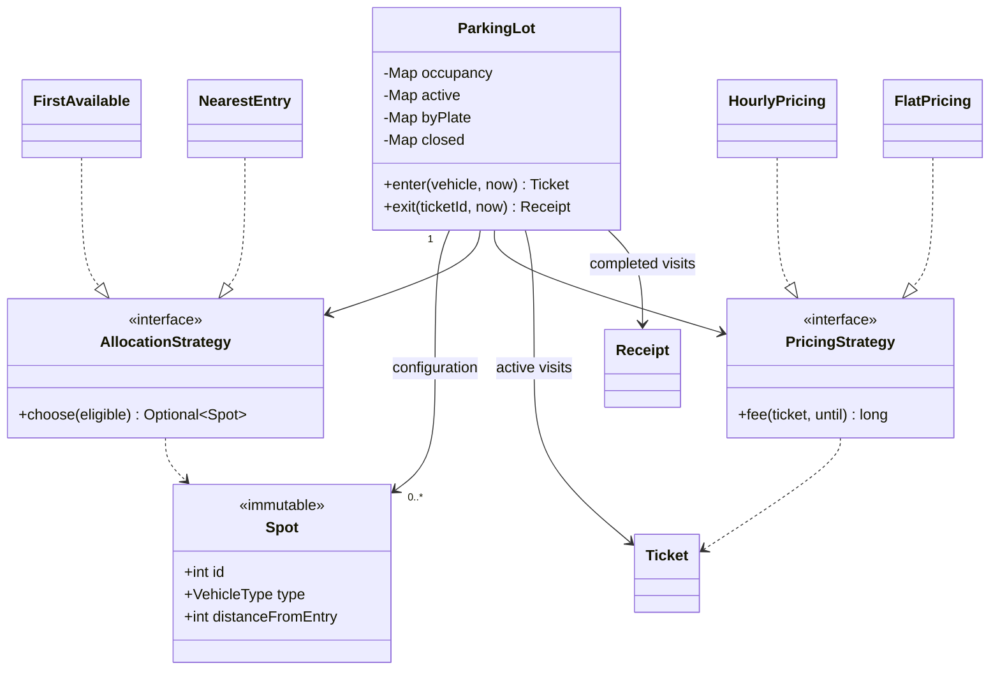

`ParkingLot` has an allocation strategy and has a pricing strategy; it does not inherit either behavior. You can combine nearest allocation with hourly pricing or flat pricing without creating subclasses for every combination.

The constructor is also where configuration is checked. Duplicate spot IDs are rejected because an occupancy map keyed by ID could otherwise treat two physical spots as one.

### Runnable code

<!-- code: checkpoint3/PolicyParkingDemo.java -->

### Dry run: change the configuration, keep the workflow

Suppose car spot 1 is 100 distance units from the entrance, and spot 2 is 10 units away. The list order is `[1, 2]`.

| Configuration | Chosen spot | Charge after 60 minutes + 1 second |
|---|---:|---:|
| First available + hourly | 1 | INR 100 |
| Nearest entry + hourly | 2 | INR 100 |
| Nearest entry + flat INR 75 | 2 | INR 75 |

The sample executable checks the first choice, the nearest choice, and flat pricing. The table also follows directly from the independently tested hourly calculation.

The nearest strategy uses distance, then spot ID as a deterministic tie-breaker. “Nearest” here is to one fixed reference entrance. Multiple gate objects can share the service, but true nearest-to-the-current-gate requires a gate ID and a gate-specific distance function; that extension appears later.

### Do we need a factory or inheritance hierarchy now?

No factory is required merely because an interface exists. In this program, constructing `new NearestEntry()` at startup makes the chosen policy explicit. A factory becomes useful when runtime configuration such as `allocationMode = NEAREST` must select and construct a configured implementation.

Similarly, separate `BikeSpot` and `CarSpot` subclasses are unnecessary when the only difference is a type value. Subclasses make more sense if their behavior and constraints differ substantially. A charger capability, dimensions or permit rules may also be better represented as fields or composed policies than as a growing subtype tree.

### Connect this to SOLID without reciting acronyms

| Principle | Concrete example | Limit to remember |
|---|---|---|
| Single responsibility | Pricing implementations own tariff calculations | The lot still legitimately coordinates one parking use case |
| Open/closed | Add a different pricing implementation without editing `exit()` | A new vehicle category may still require changes to enums, configuration and compatibility |
| Liskov substitution | Every allocation strategy returns an eligible candidate or no result | An implementation that chooses outside the supplied list breaks the contract |
| Interface segregation | Allocation and pricing have separate small interfaces | Avoid one interface containing park, charge, print and notify |
| Dependency inversion | The lot depends on policy interfaces, supplied from outside | An interface around every data class adds no value |

**Checkpoint question:** Does introducing a Strategy interface make allocation thread-safe? No. We separated a decision; we have not protected concurrent mutations.

## 4. Checkpoint four: failures and simultaneous requests

**New requirement:** Multiple gates share the same lot. Payment can succeed, be declined, or have an unknown outcome. Repeated requests must be safe. Keep the spot until confirmed payment and logical exit.

### First derive the states

An immutable ticket contains facts about entry. The mutable lifecycle belongs to an internal `Session`:

| State | What it means | Does the session still own the spot? |
|---|---|---|
| ACTIVE | Entered; no successful payment, and no unresolved attempt | Yes |
| PAYMENT_PENDING | A payment attempt exists; its outcome is unresolved or being checked | Yes |
| PAID | Payment success is confirmed; logical exit has not occurred | Yes |
| CLOSED | Logical exit completed and the receipt is stored | No |

The caller receives an immutable `Ticket`, not the mutable `Session`. Otherwise a caller could change its own status to `PAID` and bypass the workflow.

### UML: ticket lifecycle

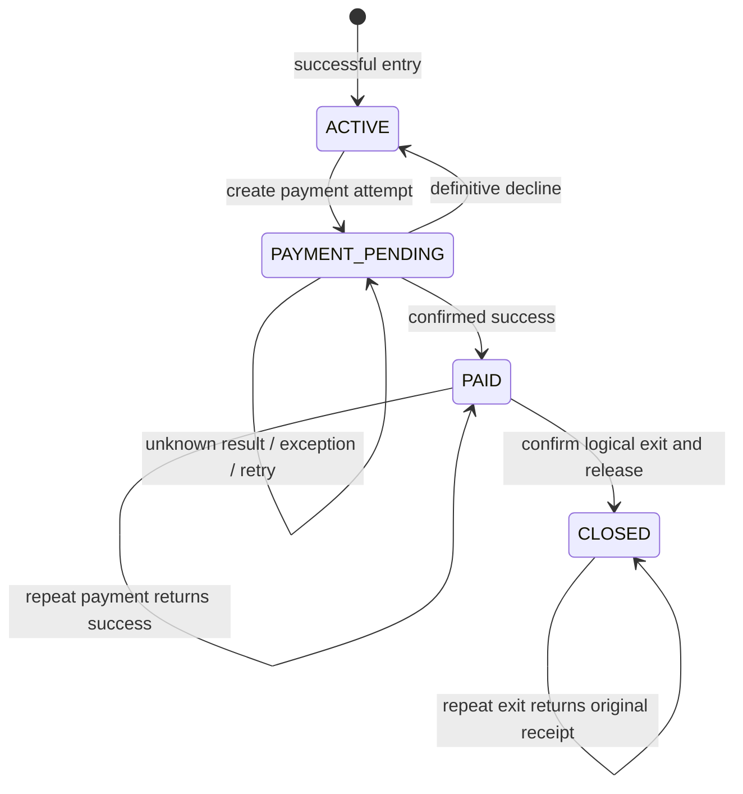

Do not add a separate `PAYMENT_FAILED` state unless it has distinct business behavior. Here, a definitive decline returns to `ACTIVE`, from which another attempt is allowed. An unresolved attempt cannot return to `ACTIVE`, because the provider may already have taken the money.

### Payment outcomes are not a boolean

Consider a provider charging INR 100 and sending a success response that never reaches the parking application. Treating a timeout as “failed” and sending a new charge can take INR 100 twice.

The interface therefore distinguishes:

- `SUCCESS`: record `PAID`.
- `DECLINED`: the provider definitively says this attempt did not charge; allow a new attempt key.
- `UNKNOWN` or an exception: keep `PAYMENT_PENDING`; retry or reconcile with the same key and amount.

Each logical attempt has a key such as `ticketId:attemptNumber`. Reusing a key with a different amount violates the processor contract. After a definitive decline, increment the attempt number. After an unknown outcome, preserve it. The fake processor implements this contract in memory; a real adapter must use the provider's supported idempotency and status-query behavior.

### Why store a Quote?

If the first request is INR 100 and the retry crosses another billing boundary, recomputing INR 150 under the same key is inconsistent. Store a `Quote(pricedUntil, amountPaise)` before making the attempt.

For this teaching version, the first quote stays fixed for the rest of the visit, including declined attempts. There is no expiration or post-payment grace limit. That is a deliberate simplification, not a recommended commercial tariff: a real lot should define quote expiration and an exit grace period. Never replace the amount while an old attempt remains unresolved.

### UML: the final executable model

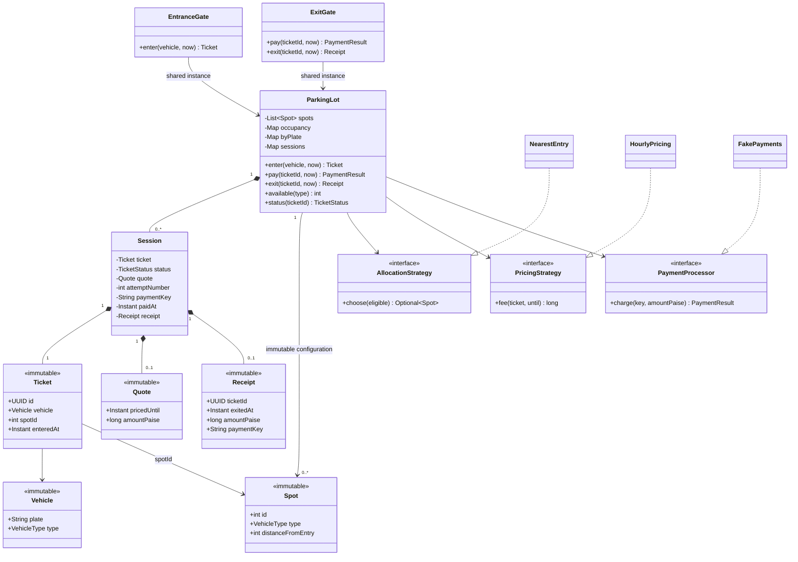

The final demo keeps one concrete allocation policy and one pricing policy so you can focus on the lifecycle. Checkpoint 3 contains the other interchangeable implementations. Gate classes are thin adapters; every gate must reference the same `ParkingLot` instance for this locking design to work.

### Why a thread-safe map would not fix allocation

Two gates can interleave as follows:

| Time | Gate A | Gate B |
|---|---|---|
| 1 | Reads spot S as free | |
| 2 | | Reads spot S as free |
| 3 | Assigns S to ticket A | |
| 4 | | Assigns S to ticket B |

Even if every individual map operation is thread-safe, the combined check-and-assign operation is not automatically atomic. We must protect eligibility checking, selecting a spot, occupying it, and recording the ticket/plate together.

The demo makes the service operations `synchronized` on the shared lot instance. This also protects exit, status reads and availability snapshots. One gate completes its state change before another gate starts an operation on that instance. Private mutable state cannot escape through a returned object.

### UML: entry under the shared lot lock

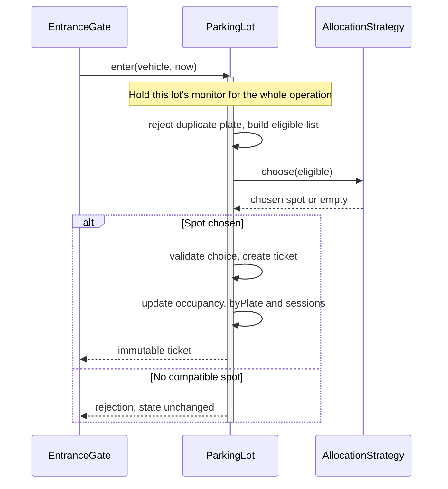

This lock is intentionally broad. It is easy to explain and sufficient for a small in-memory exercise. It serializes independent entries, and the fake payment call also runs while holding it. A slow real payment request would block unrelated operations. The later production section explains the next boundary; the sample does not claim network-ready concurrency.

### UML: a lost response, retry and exit

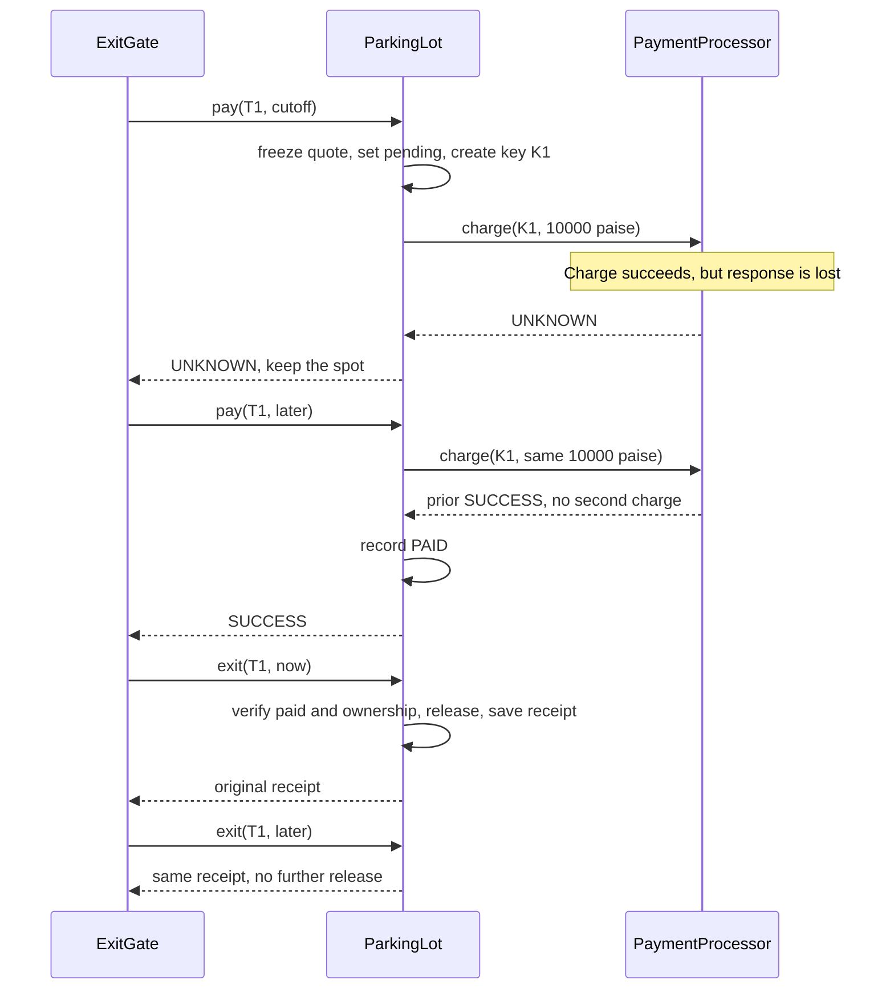

### Runnable code

The fake can return scripted outcomes, including a successful charge whose response is lost. The executable contains behavioral checks; they throw on failure even without Java's `-ea` flag.

<!-- code: checkpoint4/PaymentParkingDemo.java -->

### A full dry run

There is one car spot, S1. The car rate is INR 50 per started hour.

| Step | Event | State | Occupancy | Financial effect |
|---|---|---|---|---|
| 1 | A enters at 10:00 | ACTIVE | S1 → T1 | None |
| 2 | Another car attempts entry | ACTIVE | S1 → T1 | Rejected; no mutation |
| 3 | A requests payment at 11:00:01 | PAYMENT_PENDING | S1 → T1 | Quote fixed at INR 100, key T1:1 |
| 4 | Provider declines | ACTIVE | S1 → T1 | No successful charge |
| 5 | A retries payment | PAYMENT_PENDING | S1 → T1 | New attempt T1:2, same quote |
| 6 | Provider charges but response is unknown | PAYMENT_PENDING | S1 → T1 | Provider has one successful INR 100 charge |
| 7 | Exit is attempted | PAYMENT_PENDING | S1 → T1 | Rejected; payment not confirmed locally |
| 8 | Payment is retried at 12:00:01 | PAID | S1 → T1 | Same T1:2 resolves success; no extra charge |
| 9 | Logical exit confirmed | CLOSED | Empty | INR 100 receipt saved |
| 10 | Exit repeated | CLOSED | Empty | Original receipt returned |
| 11 | A enters again with T2 | T2 ACTIVE | S1 → T2 | New visit |
| 12 | Old T1 exit repeated again | T1 CLOSED | S1 → T2 | T2's occupancy is untouched |

### What the executable checks

The final `main()` checks minimum billing, exact-hour billing, a one-nanosecond boundary, negative duration, duplicate plates, full/incompatible capacity, unknown tickets, unpaid exit, decline/retry, unresolved outcomes, thrown payment exceptions, stable quotes, repeated payment, repeated exit, re-entry, old-ticket isolation, duplicate configuration IDs, blank plates and two concurrent gates competing for one spot.

The concurrency check starts two workers behind a latch and asserts exactly one succeeds. It is a useful regression check, not a formal proof of every schedule. The correctness argument is that all relevant mutations and reads share one monitor and mutable session state stays internal.

### Where this model deliberately ends

- State and the fake provider's idempotency records disappear on restart. No persistence or crash recovery is implemented.
- Completed sessions/receipts are retained indefinitely. A real retention policy must preserve retry guarantees while bounding storage.
- Quoted fees never expire. There is no charge for staying longer after the initial quote.
- The final `exit()` represents logical departure confirmation. Barrier opening, crossing sensors, no-shows and physical spot occupancy require more states and event handling.
- Availability is a snapshot. Seeing “1 free” does not reserve that spot; `enter()` remains authoritative.
- The code validates the essential learning boundaries; it does not implement authentication, license-plate recognition, operator permissions or a complete plate-format policy.
- Timing is supplied by the trusted caller for deterministic examples. Real adapters should use a server clock and handle clock corrections according to policy.

## 5. Alternative designs and interview follow-ups

These are design sketches, not additional runnable versions. Use them when a new requirement justifies the extra objects.

### A. A manager/factory-oriented vocabulary

You may encounter designs organized around `ParkingSpotManager`, `ParkingStrategy`, `CostComputation`, `PricingStrategy`, `EntranceGate` and `ExitGate`. Here is one possible decomposition, shown to help you translate responsibilities. It is not presented as a reconstruction of the inaccessible video.

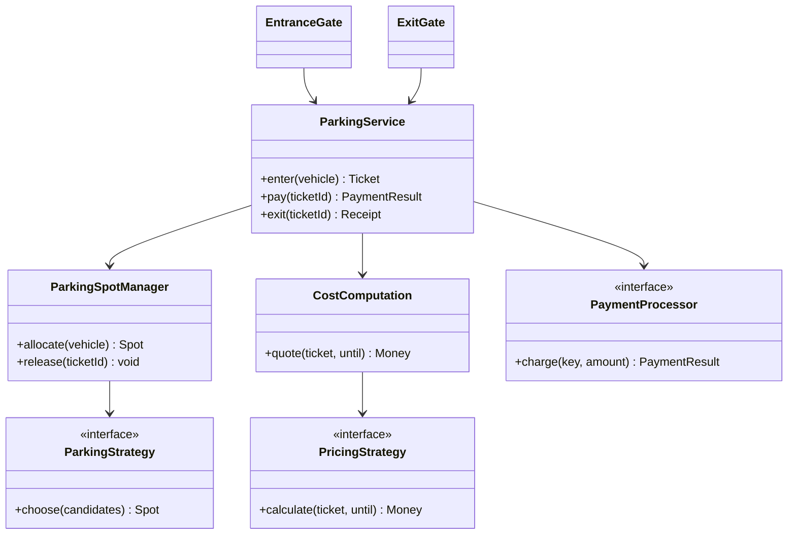

| Responsibility | This guide's implementation | Alternative name or owner |
|---|---|---|
| Own occupancy and allocate | `ParkingLot` plus `AllocationStrategy` | `ParkingSpotManager` plus `ParkingStrategy` |
| Calculate a fee | `PricingStrategy` | `CostComputation` delegating to tariff strategies |
| Coordinate tickets and payment | `ParkingLot` | `ParkingService` |
| Select an implementation from configuration | Constructor calls in `main()` | A factory |

Separating `ParkingSpotManager` becomes useful when inventory operations grow. It also creates a new question: who atomically coordinates spot assignment with ticket creation? A manager returning a free spot without claiming it is insufficient. A service lock or transaction must still encompass the related state changes.

Separate two-wheeler and four-wheeler managers can work if they encapsulate genuinely different rules. If both merely scan lists and mark occupancy, a shared manager with typed configuration avoids duplicating that logic. `CostComputation` is useful if it coordinates taxes, discounts or tariff selection; a pass-through wrapper around a single strategy is optional.

### B. Multiple floors and gate-specific distance

Add `ParkingFloor` when floor identity affects allocation, closures, capacity or displays. Give spots globally unique IDs or use a composite `(floorId, spotNumber)` key.

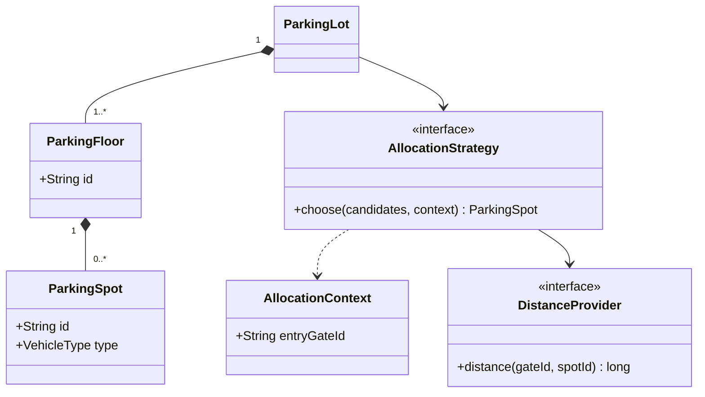

A single `distanceFromEntry` cannot express distances from every gate. Pass the current gate identity into the allocation context, then rank candidates using a distance table or function. Decide whether “nearest” means walking distance, driving distance, or lowest floor first. The algorithm cannot infer the business definition.

### C. Compatibility beyond exact type matching

If bikes may use car spaces, do not rely on enum ordinals to imply size. Define a compatibility matrix or `FitPolicy`. Then define preference separately: perhaps bike spots first, car spots only as fallback.

A truck needing several adjacent spaces changes the unit of allocation from one spot to a set. Reserve the whole compatible set atomically or reserve none. A new `TRUCK` enum value alone does not solve adjacency or partial reservation.

### D. Display boards and Observer

A display can initially call `available(type)`. If multiple displays need updates after allocation or release, emit an event after the operation commits. Subscribers can refresh their view.

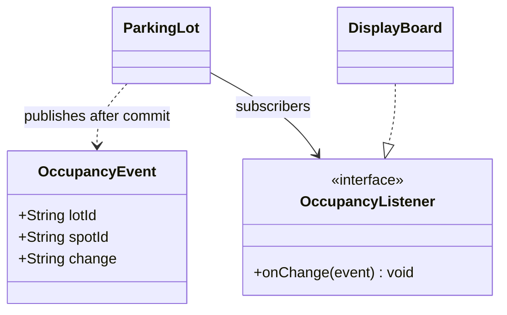

Observer is justified by the need to notify independent consumers. A display failure should not undo a successful allocation. Availability on the board may lag; the allocation service must recheck the real state.

### E. Adding discounts

You could implement a pricing decorator that wraps another `PricingStrategy`, obtains its amount, and applies a discount. That is useful when combinations of adjustments need to compose. Specify order: applying a cap before a discount may produce a different result from discounting before capping. Define rounding in minor units and keep the result nonnegative.

### F. Should ParkingLot be a Singleton?

Multiple gates need the same service instance. Constructor injection already achieves that. A Singleton is not required by the fact that today's example has one lot, and it complicates isolated tests and multiple-lot deployments. “One shared instance in this application” and “a globally enforced Singleton type” are different choices.

## 6. From an interview demo to durable operations

The following is a production discussion, not a claim that the sample implements distributed transactions.

### Move real payments outside the inventory lock

1. In a short transaction or lock, load the session, freeze the quote, and create or find its pending payment attempt. Persist the key and amount.
2. Release that transaction/lock before calling the payment provider.
3. Call the provider using the saved key. An unknown result keeps the attempt pending.
4. In a new transaction, apply the confirmed outcome only if it still corresponds to that attempt. A version or conditional update prevents conflicting transitions.
5. Let logical exit atomically release the allocation, close the session and save the receipt.

Concurrent callers may reach the provider with the same key. The provider adapter must deduplicate the attempt, and the database must ensure there is only one current attempt for the visit. A crash after charging but before recording success is resolved through the saved key, provider status/retry semantics and reconciliation. A database transaction does not roll back an external charge.

### A possible durable data model

| Record | Important data and constraint |
|---|---|
| Spot | Unique spot ID, type and optional floor |
| Visit | Ticket ID, vehicle facts, assigned spot, entry time, lifecycle state |
| CurrentAllocation | Unique spot ID and unique normalized plate, referencing the current visit |
| Quote | Visit, billing cutoff, amount, currency and tariff/version identity |
| PaymentAttempt | Unique idempotency key, visit, attempt number, immutable amount, outcome, provider reference |
| Receipt | Unique ticket ID, confirmed exit time, settled amount, successful payment reference |

Historical visits can all reference the same spot. Put exclusivity on current allocations, or use an appropriate conditional uniqueness design, so historical records do not incorrectly prohibit reuse.

Two application processes do not share a Java `synchronized` monitor. Use database transactions and uniqueness/conditional updates to enforce current allocation. If the response to entry is lost, plate-based rejection only prevents duplication; it does not return the original ticket. Add an entry request idempotency key if entry retries must recover the same ticket.

## 7. Complexity and correctness review

Let `S` be the number of spots, `A` the number of current visits, and `H` the number of retained historical visits.

| Operation | Checkpoint 1 | Checkpoint 2 | Checkpoints 3–4 |
|---|---|---|---|
| Entry | O(S) scan | O(S) scan | O(S) filtering and selection |
| Exit | O(S) plate search | O(S) spot lookup | Expected O(1) map operations, excluding provider latency |
| Availability | Not exposed | Not exposed | Checkpoint 4: O(S) |
| Stored state | O(S) | O(S + A + H) | O(S + A + H), plus provider attempt history in checkpoint 4 |

Candidate lists use O(S) temporary memory in checkpoints 3–4. The nearest implementation scans for the minimum; it does not sort the entire list. Hash-map lookup is described as expected O(1), not a universal worst-case guarantee. Lock waiting and real provider latency are separate from these data-structure costs.

For a larger lot, free-spot indexes by type, ordered sets or priority queues can reduce searches. Multiple gate-specific distance orders make maintaining such indexes more complicated. Optimize after defining which order matters; an index is another piece of state that must stay consistent during allocate/release.

### Common mistakes you should be able to explain

| Mistake | Why it breaks | Better choice |
|---|---|---|
| Start with a dozen classes and patterns | There is no requirement explaining their roles | Grow the design at explicit checkpoints |
| Store mutable payment status on the returned ticket | The caller can bypass the lifecycle | Immutable ticket; internal session |
| Use only a plate to identify a visit | An old exit can target a later visit | Ticket ID per entry |
| Keep unrelated `isEmpty` and occupant values | They can contradict each other | One occupancy source |
| Free a spot before payment succeeds | Declines and timeouts lose the allocation | Release only through the exit transition |
| Treat timeout as definitive failure | A successful charge may have lost its response | Pending state and stable payment key |
| Recalculate the amount on an unresolved retry | Same key can refer to different amounts | Persist a quote/attempt amount |
| Use only a concurrent map | Compound allocation is still racy | Lock/transaction across related state changes |
| Hold a global lock during network I/O | One slow payment stalls unrelated requests | Persist attempt, call outside the lock, reconcile |
| Use integer division for started-hour billing | Partial hours are truncated | Explicit round-up rule |
| Use `double` for money | Binary fractions complicate exact monetary arithmetic | Minor units or a defined decimal-money type |
| Claim a Singleton solves multi-process coordination | Each process still has its own instance | Durable constraints and transactions |

## 8. Practice: derive the next change yourself

Try these before reading the answer notes.

1. A car parks for exactly two hours. Then try two hours plus one nanosecond. What should the charges be?
2. A bike arrives when only car spots are empty. What does the current code do? Which two decisions change if fallback is allowed?
3. You add `DailyCappedPricing`. Which workflow methods should change?
4. Two gates see the same final free spot. Which operations must share the critical section?
5. Payment was charged, but the response was lost. Which status, key and amount should the retry use?
6. A paid car remains in the lot for a day. What happens today, and which business rule is missing?
7. A duplicate exit arrives after the spot has been assigned to a new ticket. Why is the new visit safe?
8. Someone passes a strategy returning a spot outside its candidate list. Where is it rejected?
9. You deploy two JVMs, each with its own `ParkingLot`. Why can both still allocate the same physical spot?
10. The entry response is lost. How does duplicate-plate protection differ from idempotent entry recovery?

<details>
<summary>Answer notes</summary>

1. INR 100 and INR 150 for a car, respectively.
2. Entry is rejected. Add a compatibility rule and a preference order; do not accidentally make bikes consume car spots before bike spaces.
3. Supply a new strategy through configuration. Entry and exit orchestration should remain unchanged. Decide whether the cap is per rolling 24 hours, calendar day or visit.
4. Duplicate-plate check, candidate selection, occupancy claim and ticket/plate registration. Release and availability must use the same synchronization discipline.
5. `PAYMENT_PENDING`, the existing attempt key and the original quoted amount. Resolve the provider's actual outcome.
6. The quote stays fixed and the spot stays allocated until exit; no extra fee is charged. Define quote expiration and post-payment exit grace behavior.
7. The old session is already `CLOSED`; the method returns its saved receipt before touching occupancy.
8. The lot checks membership in the eligible list before creating the allocation.
9. Java monitors are process-local. Enforce allocation constraints in shared durable storage.
10. Plate protection rejects a second active entry; request idempotency lets a retry retrieve the original successful ticket.

</details>

### A suggested interview presentation

Use the first few minutes to establish types, compatibility, pricing and scope. Walk through one arrival and departure. Draw `Vehicle`, `Spot`, `Ticket` and the coordinating lot. Explain ownership and duplicate-entry protection. Introduce strategies only when describing alternate allocation or pricing. Then discuss states and the last-spot race if payments or multiple gates are in scope. Finish with a concrete failure/retry example and the limits of the in-memory model.

A concise explanation you can practice:

> Each entry creates a ticket identifying one visit. The lot owns occupancy and the current plate index. It filters compatible free spots, then delegates preference to an allocation strategy. A pricing strategy calculates a fee from the ticket and billing cutoff. Once payments are introduced, a private session tracks active, pending, paid and closed states. Pending attempts retain their key and amount; only confirmed payment followed by exit releases a spot. All mutable operations share one lot lock in the demo; persistent multi-process implementations need transactions and constraints.

## 9. Run and explore

From the `LLD` directory, using Java 17 or newer:

```powershell
java --source 17 ParkingLot/checkpoint1/BasicParkingDemo.java
java --source 17 ParkingLot/checkpoint2/TicketParkingDemo.java
java --source 17 ParkingLot/checkpoint3/PolicyParkingDemo.java
java --source 17 ParkingLot/checkpoint4/PaymentParkingDemo.java
```

Each file is standalone. Run versions separately; do not combine their nested domain models into one application. Every executable prints a checkpoint success line or throws if a check fails. The source-file launcher avoids creating compiled class files in your workspace.

The HTML edition includes rendered SVG diagrams and embedded source code. The Markdown edition keeps editable Mermaid diagrams. Use the source links or expand a checkpoint's full code to compare the design with its implementation.

**Source boundary:** The external reference is the user-supplied [Hindi parking-lot video](https://www.youtube.com/watch?v=MtjZf7291zc) and its metadata-linked [English companion](https://www.youtube.com/watch?v=g8AVGr_0Wko). All requirements, checkpoint designs, code, diagrams, tests and exercises in this document are original explanatory material. No inaccessible transcript or video-specific timestamp is represented as verified.
