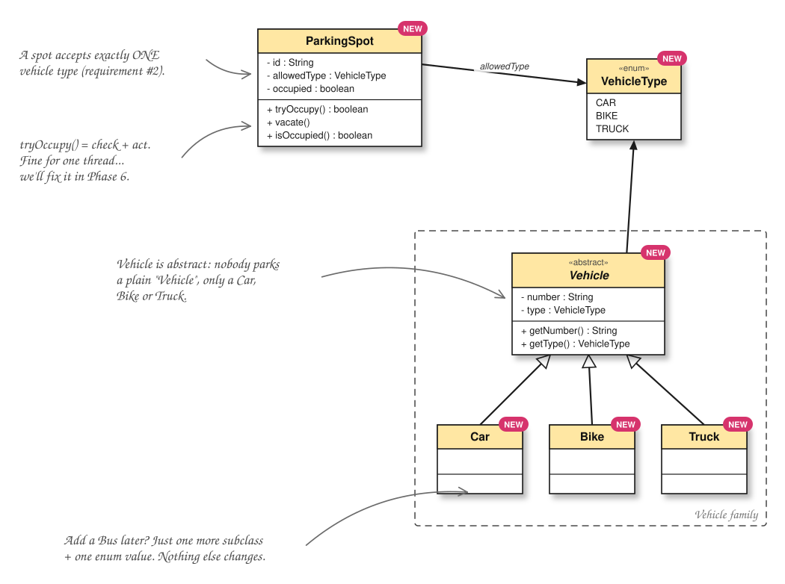

<div align="center">

# LLD Notes

**Low-level design, from the first requirement to the interview conversation.**

Study guides · UML diagrams · Annotated interview scripts · Runnable Java

[Browse the case studies](#case-study-library) · [Choose a study format](#two-ways-to-study) · [Reuse the skill](#reusable-interview-prep-skill) · [Run the code](#run-the-code)

</div>

---

This repository collects low-level design notes built for understanding a design, implementing it, and explaining the decisions aloud. It brings together video-based study packs and interview practice guides, with Java implementations you can run and rebuild yourself.

> **Start with the format that fits your session.** Read a PDF and sketch the UML to learn a design gradually. Open an annotated `.py` guide to rehearse what you would write and say in an interview. Then implement the core requirements in Phase 1 and explore extensions in Phase 2.

## Two ways to study

| | PDF + UML study packs | Annotated interview guides |
|---|---|---|
| **Start here** | A study PDF in `notes/` | The case study's main `.py` file |
| **What you read** | Concepts, worked examples, evolving class diagrams, code walkthroughs, and checkpoints | The interview conversation, from clarifying requirements through implementation and follow-ups |
| **What you see** | UML class and sequence diagrams, plus source-video screenshots | Talking points, design choices, tricky cases, rubric notes, and supporting images where available |
| **What you build** | Six complete Java snapshots under `phases/` | Phase 1 core requirements and Phase 2 extensions, usually under `code/` |
| **How you practise** | Read → sketch → retype → run → answer the checkpoints | Read → explain aloud → attempt the workbooks → review → implement |

Some topics offer both formats. Each has its own design progression and folder layout. The library below links to the actual files.

### PDF + UML study packs

The Parking Lot, Splitwise, Rate Limiter, and BookMyShow packs follow Shubh Patel's video case studies. They use the explanation, source frames, and reference code where available to build a phase-by-phase learning path. BookMyShow's video-based implementation was reconstructed from the transcript and frames, as documented in its source notes. [BookMyShow sources](case-studies/bookmyshow/SOURCES.md)

Each pack brings together a PDF, growing UML diagrams, screenshots, and six independently runnable Java phases. Every phase contains the complete source for that stage. Later phases add capabilities, address concurrency, or explore improvements described in the topic's notes.

```text
case-studies/<topic>/
├── notes/          PDF study guide
├── diagrams/       Class and sequence diagrams
├── screenshots/    Reference frames from the video
├── phases/         Six complete Java implementation snapshots
└── README.md       Study roadmap, phase map, and run instructions
```

<details>
<summary><strong>Preview a UML page from the Parking Lot pack</strong></summary>



Follow the diagrams alongside the corresponding PDF pages and Java phases. [Open the Parking Lot study roadmap](case-studies/parking-lot/README.md)

</details>

### Annotated interview guides

These guides put the full interview into a single `.py` file, including what you would write in the editor and what you would say to the interviewer. Open them as study documents. They combine prose, pseudocode, implementation sketches, and annotations, with runnable Java supplied alongside them.

The format follows the five-step delivery framework demonstrated by Evan King in Hello Interview's Amazon Locker case study. Amazon Locker annotates that source interview. The other guides apply the framework to their own problems, including topics with no accompanying video. Source and method details live in each case study's README. [Amazon Locker guide](case-studies/amazon-locker/README.md)

**Requirements → Entities → Class design → Implementation → Extensibility**

| Annotation | What it helps you practise |
|---|---|
| 💬 **SAY** | The questions, reasoning, and explanations to speak aloud |
| ⚠️ **TRICKY** | Edge cases, subtle bugs, and common interview mistakes |
| ✅ **BEST** | The chosen approach and the reasoning behind it |
| 🎯 **GRADED** | The interview skill being assessed at that point |
| ⏱ **Time budget** | How long to spend on a step |

The `.py` guide is the main reading material for this format. A PDF or full UML pack is optional. Some guides include extra visual aids, such as BookMyShow's object map and request-flow diagram.

The practice material typically follows this layout. Use the library links for the exact location of each Java implementation.

```text
<interview-guide>/
├── <topic>.py      Complete annotated interview walkthrough
├── workbook/      Five exercises, including guided and blank implementation
├── answer-key/    Scoring keys for reviewing your attempts
├── attempts/      Dated practice attempts and evaluation reports
├── RULEBOOK.md    Practice instructions and evaluation rubric
└── code/
    ├── Phase-1-Core-Requirements/
    └── Phase-2-Extensions/
```

**Phase 1** implements the agreed core requirements. **Phase 2** extends that design with the topic's follow-ups, such as pricing strategies, notification hooks, retry policies, or additional algorithms. Each phase has its own source and `run.sh`, and the Java `Main` programs include self-checks.

## Case study library

| Case study | PDF and UML pack | Interview walkthrough | Phase 1 + Phase 2 Java |
|---|---|---|---|
| **Amazon Locker** | — | [amazon_locker.py](case-studies/amazon-locker/amazon_locker.py) | [Code and guide](case-studies/amazon-locker/code/README.md) |
| **BookMyShow** | [PDF](case-studies/bookmyshow/notes/BookMyShow_LLD_Study_Notes.pdf) · [UML](case-studies/bookmyshow/diagrams/) | [bookmyshow.py](case-studies/bookmyshow/hello-interview-bookmyshow/bookmyshow.py) | [Code and guide](case-studies/bookmyshow/hello-interview-bookmyshow/code/README.md) |
| **Job Scheduler** | — | [job_scheduler.py](case-studies/job-scheduler/job_scheduler.py) | [Code and guide](case-studies/job-scheduler/code/README.md) |
| **LLM Usage Limits** | — | [llm_usage_limits.py](case-studies/llm-usage-limits/llm_usage_limits.py) | [Code and guide](case-studies/llm-usage-limits/code/README.md) |
| **Notification Router** | — | [notification_router.py](case-studies/notification-router/notification_router.py) | [Code and guide](case-studies/notification-router/code/README.md) |
| **Parking Lot** | [PDF](case-studies/parking-lot/notes/ParkingLot_LLD_Study_Notes.pdf) · [UML](case-studies/parking-lot/diagrams/) | Study narrative in the PDF | [Code and guide](case-studies/parking-lot/code/README.md) |
| **Rate Limiter** | [PDF](case-studies/rate-limiter/notes/RateLimiter_LLD_Study_Notes.pdf) · [UML](case-studies/rate-limiter/diagrams/) | [rate_limiter.py](case-studies/rate-limiter/rate_limiter.py) | [Code and guide](case-studies/rate-limiter/hello-interview-rate-limiter/README.md) |
| **Splitwise** | [PDF](case-studies/splitwise/notes/Splitwise_LLD_Study_Notes.pdf) · [UML](case-studies/splitwise/diagrams/) | Study narrative in the PDF | [Code and guide](case-studies/splitwise/code/README.md) |

Parking Lot and Splitwise include both a six-phase PDF study pack and a separate two-phase Java design. BookMyShow's interview guide lives under `hello-interview-bookmyshow/`. Rate Limiter's annotated guide lives at the topic root, with its two-phase Java code under `hello-interview-rate-limiter/`.

Parking Lot also has a four-checkpoint study path with standalone examples and an offline HTML guide. [Open the checkpoint guide](case-studies/parking-lot/phases/checkpoints/README.md)

## A practice session

For a **PDF study pack**, read one phase, sketch its class relationships, then rebuild its new behaviour from the preceding phase. Run the example, compare the result, and answer the checkpoint questions aloud before moving on.

For an **interview guide**, work through this loop.

1. Read the main `.py` file and speak the **SAY** notes aloud.
2. Close the guide and copy an exercise from `workbook/` into a dated `attempts/` folder.
3. Follow the exercise's time limit and write both your solution and your explanation.
4. Review the attempt using the case study's rulebook and scoring key, or ask an AI evaluator to follow that rubric.
5. Rebuild the Java Phase 1 solution, then explain how Phase 2 adds each extension.

| Workbook | Practice focus |
|---|---|
| `01_requirements.py` | Clarifying capabilities, errors, and scope |
| `02_entities_and_class_design.py` | Choosing entities, responsibilities, and APIs |
| `03_implementation_guided.py` | Implementing with hints and edge-case prompts |
| `04_implementation_blank.py` | Rebuilding the implementation from memory |
| `05_extensibility.py` | Explaining and designing follow-up requirements |

Do the blank implementation on a different day from the guided exercise so the hints have time to fade. The rulebook explains how to record attempts and evaluate them. [Read the practice rulebook](case-studies/amazon-locker/RULEBOOK.md)

## Reusable interview prep skill

The **`lld-interview-prep`** skill packages the workflow behind the annotated interview format so you can build a study pack for another LLD topic or video, or evaluate a completed workbook attempt. It follows the same five-step Hello Interview framework described above. [Download the skill ZIP](resources/skills/lld-interview-prep.zip)

| Mode | What it produces |
|---|---|
| **Create** | An annotated `.py` walkthrough, five workbooks, five answer keys, a rulebook, a case-study README, and runnable Java for Phase 1 core requirements and Phase 2 extensions |
| **Evaluate** | A review of a submitted attempt using the case study's rulebook and answer key, including scoring and feedback |

The archive includes the skill instructions, framework notes, the Amazon Locker transcript and editor reference, 17 source screenshots, a complete Amazon Locker practice pack, a two-phase Notification Router Java example, and a rulebook template.

```text
lld-interview-prep/
├── SKILL.md
├── reference/
│   ├── framework.md
│   ├── amazon_locker_original.py
│   ├── amazon_locker_transcript.txt
│   ├── screenshots/
│   ├── example-amazon-locker/
│   └── example-code-notification-router/
└── templates/
    └── RULEBOOK.md
```

### Use the bundle

1. Download and extract the ZIP, keeping `SKILL.md`, `reference/`, and `templates/` together.
2. Give your coding agent the extracted `SKILL.md` path and your local repository root.
3. Specify a topic or video for creation, or the completed attempt and case-study folder for evaluation.

The bundled instructions contain the original author's macOS output path and video-download setup. When using the skill, explicitly set the destination to your own checkout and adapt the download tools to your operating system.

For example, after replacing the paths with your own, ask your agent to create a pack.

```text
Read <extracted-folder>/lld-interview-prep/SKILL.md and use its Create mode
to build an Elevator interview-prep pack.

Use <repo-root>/case-studies/elevator/ as the output directory and update
<repo-root>/README.md. Override the bundled machine-specific paths with
these locations and adapt any tool setup to this operating system.
Use senior level, annotated pseudocode, and runnable Java for both phases.
```

To review an attempt, give the agent the files to evaluate and the matching rubric.

```text
Read <extracted-folder>/lld-interview-prep/SKILL.md and use its Evaluate mode.
Evaluate <repo-root>/case-studies/amazon-locker/attempts/<date>/01_requirements.py
using that case study's RULEBOOK.md and matching answer key.
```

## Run the code

Use **JDK 17 or newer**, with `java` and `javac` on your `PATH`. Run the commands below from the repository root. The shell scripts work with Bash, including Git Bash on Windows, or WSL with a JDK installed in that environment.

### Run an interview design

```bash
bash case-studies/amazon-locker/code/Phase-1-Core-Requirements/run.sh
bash case-studies/amazon-locker/code/Phase-2-Extensions/run.sh
```

### Run a phase from a PDF study pack

```bash
bash case-studies/parking-lot/phases/Phase-1-Vehicles-and-Spots/run.sh
```

BookMyShow's six-phase PDF pack also includes PowerShell runners.

```powershell
& .\case-studies\bookmyshow\phases\Phase-1-Venues-and-Seats\run.ps1
```

Each runner compiles and runs its own phase. Consult the linked code guide for its expected output, self-checks, and simulated dependencies.

## Design patterns

The `patterns/` folder contains focused Java examples to study alongside the larger designs. Each pattern pairs a `bad/` implementation with a `good/` implementation and explains the design change in its README.

| Pattern | Example | Study guide |
|---|---|---|
| **Strategy** | Interchangeable duck behaviours | [Read and run](patterns/Strategy/README.md) |
| **Observer** | Push and pull weather updates | [Read and run](patterns/Observer/README.md) |
| **Decorator** | Composing coffee orders | [Read and run](patterns/Decorator/README.md) |

## Repository map

```text
LLD-Notes/
├── case-studies/
│   ├── amazon-locker/
│   ├── bookmyshow/
│   │   └── hello-interview-bookmyshow/
│   ├── job-scheduler/
│   ├── llm-usage-limits/
│   ├── notification-router/
│   ├── parking-lot/
│   ├── rate-limiter/
│   │   └── hello-interview-rate-limiter/
│   └── splitwise/
├── patterns/
│   ├── Strategy/
│   ├── Observer/
│   └── Decorator/
└── resources/      Reference reading and reusable skill bundles
    └── skills/
        └── lld-interview-prep.zip
```

The reference library includes *Head First Design Patterns*. Topic READMEs record their sources and explain adaptations, fixes, and extensions to the original material. [Browse the resources](resources/)
