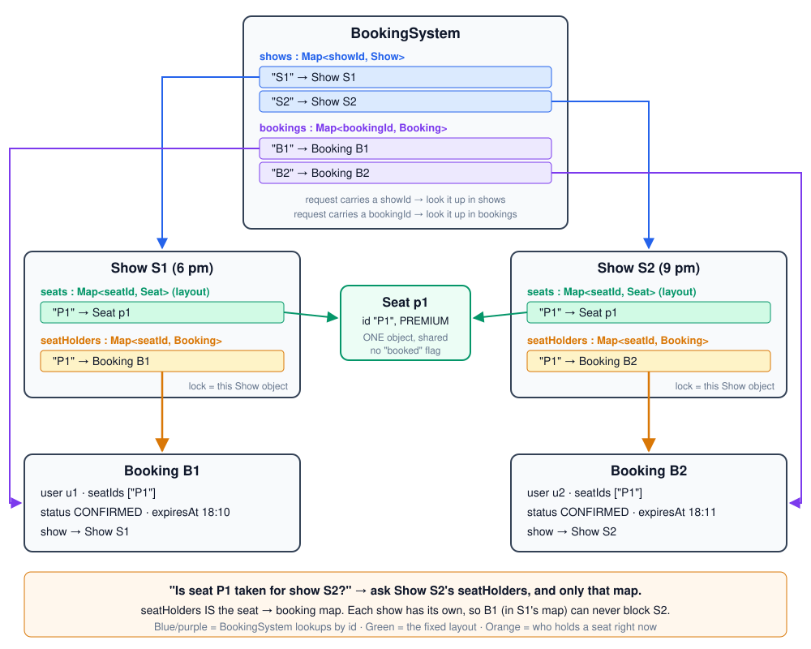
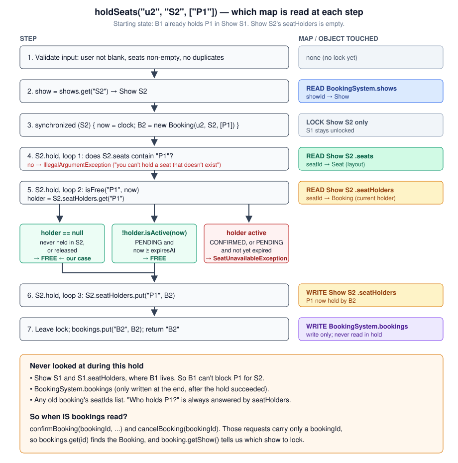

# How a booking flows through the code

A guided walk through the Phase 1 Java code ([`code/Phase-1-Core-Requirements/`](code/Phase-1-Core-Requirements/src/bookmyshow/)). It starts with the happy path, then shows five cases where timing or concurrency could go wrong and how the code handles each one.

## The only 4 classes you need

Ignore the exceptions and enums for now. Four classes do all the work:

| Class | What it is | What it holds |
|---|---|---|
| [`Seat`](code/Phase-1-Core-Requirements/src/bookmyshow/model/Seat.java) | A physical chair, e.g. `A1` | id + type. **Never changes.** No "booked" flag. |
| [`Show`](code/Phase-1-Core-Requirements/src/bookmyshow/model/Show.java) | One screening, e.g. "Dune, 6 pm" | its seats + **`seatHolders`: seatId → Booking**. Its built-in Java lock is the show's lock. |
| [`Booking`](code/Phase-1-Core-Requirements/src/bookmyshow/model/Booking.java) | A hold that later becomes a ticket | user, seat ids, `expiresAt`, status (PENDING → CONFIRMED / CANCELLED) |
| [`BookingSystem`](code/Phase-1-Core-Requirements/src/bookmyshow/service/BookingSystem.java) | The front desk: every call starts here | all shows by id, all bookings by id, the clock |

Remember these two ideas and the rest follows:

1. **A seat is taken if its holder in `seatHolders` is active.** Active means CONFIRMED, or PENDING with `now < expiresAt`. Nothing is ever deleted when a hold runs out; an expired holder simply stops counting. This is called *lazy expiry*.
2. **Every read-then-write on a show happens inside `synchronized (show)`.** Two calls on the same show take turns. Calls on different shows run in parallel.

---

## Part 1: The happy path

### Step 1. Set up a show with seats

```java
List<Seat> layout = List.of(new Seat("A1", REGULAR), new Seat("A2", REGULAR),
                            new Seat("A3", REGULAR), new Seat("P1", PREMIUM));
Show s1 = new Show("S1", layout);
BookingSystem system = new BookingSystem(List.of(s1), clock);
```

What happens:
- `Show`'s constructor copies the seats into its `seats` map and rejects a null or duplicate seat id.
- `BookingSystem`'s constructor indexes shows by id and rejects a duplicate show id. Bad setup fails here, at startup, not halfway through a booking.

State now (`seatHolders` is empty, so every seat is free):

```
Show S1
  seats:       A1  A2  A3  P1
  seatHolders: {}
```

The same `Seat` list can be reused for the 9 pm show. That's safe because whether a seat is taken lives in each show's own `seatHolders`, not on the `Seat`.

### Step 2. User u1 reserves (holds) A1 and A2 at 18:00

```java
String b1 = system.holdSeats("u1", "S1", List.of("A1", "A2"));   // returns "B1"
```

Inside [`BookingSystem.holdSeats`](code/Phase-1-Core-Requirements/src/bookmyshow/service/BookingSystem.java):

```
1. validate input            no lock: user not blank, seat list non-empty, no duplicates
2. findShow("S1")            the single Show object for S1 (or ShowNotFoundException)
3. synchronized (show) {     take S1's lock; other S1 calls wait here
4.     now = clock.instant() read the time INSIDE the lock
5.     new Booking B1        PENDING, expiresAt = 18:10 (now + 10 min)
6.     show.hold(B1, now)    see below
   }                         lock released
7. bookings.put("B1", B1)    only stored because the hold succeeded
8. return "B1"
```

Inside [`Show.hold`](code/Phase-1-Core-Requirements/src/bookmyshow/model/Show.java), there are three loops, in this order:

```
loop 1: every seat id exists in this show?    no  -> IllegalArgumentException
loop 2: every seat free right now?            no  -> SeatUnavailableException
loop 3: write seatHolders[seat] = B1 for each seat
```

It checks every seat before writing any seat, so a failed hold changes nothing (all-or-nothing).

State now:

```
seatHolders: { A1 -> B1(PENDING, until 18:10),  A2 -> B1(PENDING, until 18:10) }
free seats:  A3  P1
```

### Step 3. u1 pays at 18:05, so we confirm

```java
system.confirmBooking("B1", "pay_123");
```

Inside [`BookingSystem.confirmBooking`](code/Phase-1-Core-Requirements/src/bookmyshow/service/BookingSystem.java):

```
1. paymentRef not blank, else IllegalArgumentException
2. findBooking("B1")                        or BookingNotFoundException
3. synchronized (B1.getShow()) {            the SAME lock as hold
4.     now = clock.instant()                18:05
5.     already CONFIRMED?   return          payment callbacks retry, so this is a no-op
6.     CANCELLED?           IllegalStateException
7.     expired (now >= 18:10)? HoldExpiredException
8.     B1.confirm("pay_123")                status = CONFIRMED
   }
```

`seatHolders` doesn't change. A1 and A2 already point at B1. What changes is B1's status, and a CONFIRMED booking stays active forever, so the seats stay taken after 18:10:

```
seatHolders: { A1 -> B1(CONFIRMED),  A2 -> B1(CONFIRMED) }
```

### (Step 4. Cancel)

```java
system.cancelBooking("B1");
```

Under the same lock, `show.release(B1)` removes each of B1's seats **only if the seat still points at B1**, then B1 becomes CANCELLED. Cancelling twice is a no-op.

That's the whole system: `seatHolders` is the only thing that says who has a seat, and one lock per show guards it.

---

## Part 1.1: The same seat, booked for two different shows

There's one physical seat, `P1`, and two screenings in the same hall: S1 at 6 pm and S2 at 9 pm. Both u1 and u2 want P1, u1 for S1 and u2 for S2. There's one seat per booking and the calls run one after the other (no concurrency).

### Setup: one layout, two shows

```java
Seat p1 = new Seat("P1", PREMIUM);
List<Seat> layout = List.of(p1);                  // a layout with a single seat

Show s1 = new Show("S1", layout);                 // 6 pm
Show s2 = new Show("S2", layout);                 // 9 pm, SAME layout list
BookingSystem system = new BookingSystem(List.of(s1, s2), clock);
```

- Each `Show` constructor copies the layout into **its own** `seats` map. The maps are separate, but both contain **the same `Seat` object** `p1`. Java copies the reference, not the seat. That's fine because a `Seat` is just an id and a type and never changes.
- Each `Show` starts with its **own empty** `seatHolders` map.
- `BookingSystem` stores both shows by id: `{"S1" -> s1, "S2" -> s2}`.

```
            Seat p1 (id P1, PREMIUM)       <- one object in memory
             ^                   ^
             |                   |
Show S1                          Show S2
  seats:       {P1 -> p1}          seats:       {P1 -> p1}
  seatHolders: {}                  seatHolders: {}
```

### Request 1: u1 books P1 for S1 (18:00)

```java
String b1 = system.holdSeats("u1", "S1", List.of("P1"));   // "B1"
system.confirmBooking(b1, "pay_1");
```

1. `holdSeats` → `findShow("S1")` returns **s1**.
2. `synchronized (s1)`: now = 18:00. It creates `Booking B1(u1, show=s1, [P1], PENDING, until 18:10)`.
3. `s1.hold(B1)`: is P1 in **s1**'s seats? Yes. Is P1 free in **s1**'s `seatHolders`? Yes, it's empty. It writes `s1.seatHolders[P1] = B1`.
4. `bookings["B1"] = B1`, and it returns "B1".
5. `confirmBooking("B1")` → finds B1 → `synchronized (B1.getShow())`, which is **s1** → B1 is not expired → B1 becomes CONFIRMED.

**S2 was never touched.** Nothing in this request looked at s2.

### Request 2: u2 books P1 for S2 (18:01)

```java
String b2 = system.holdSeats("u2", "S2", List.of("P1"));   // "B2"
system.confirmBooking(b2, "pay_2");
```

1. `holdSeats` → `findShow("S2")` returns **s2**.
2. `synchronized (s2)`: now = 18:01. It creates `Booking B2(u2, show=s2, [P1], PENDING, until 18:11)`.
3. `s2.hold(B2)`: is P1 in **s2**'s seats? Yes. Is P1 free in **s2**'s `seatHolders`? **Yes.** s2's map is still empty. B1 lives only in s1's map, so s2 never sees it. It writes `s2.seatHolders[P1] = B2`.
4. `bookings["B2"] = B2`, and it returns "B2".
5. `confirmBooking("B2")` → locks **s2** → B2 becomes CONFIRMED.

Both bookings succeed. That's correct: one chair can be sold once per screening.

### Final state of every object

```
Seat p1                 id = P1, type = PREMIUM            (unchanged, shared by both shows)

Show S1                 seats       = {P1 -> p1}
                        seatHolders = {P1 -> B1}

Show S2                 seats       = {P1 -> p1}
                        seatHolders = {P1 -> B2}

Booking B1              user = u1, show = S1, seatIds = [P1],
                        status = CONFIRMED, paymentRef = pay_1, expiresAt = 18:10 (ignored once confirmed)

Booking B2              user = u2, show = S2, seatIds = [P1],
                        status = CONFIRMED, paymentRef = pay_2, expiresAt = 18:11 (ignored once confirmed)

BookingSystem           shows    = {S1 -> s1, S2 -> s2}
                        bookings = {B1 -> B1, B2 -> B2}
                        nextId   = 3        (one counter for the whole system, so ids never repeat across shows)
```

`getAvailableSeats("S1")` and `getAvailableSeats("S2")` both return `[]` now. Each show's only seat is taken in that show.

### Why this works, and what would break it

"Taken" is stored **per show** (`Show.seatHolders`), never on the `Seat`. If `Seat` had a `boolean booked` field, request 1 would set `p1.booked = true` on the shared object, and request 2 would wrongly see P1 as taken for the 9 pm show too. That's why `Seat` has no booked flag. (Phase 1 `Main`'s `demoWithSystemClock` checks this: P1 booked at 6 pm, still free at 9 pm.)

---

## Part 1.2: All the maps in one picture

There are only **four maps** in the whole system. Two live on `BookingSystem` and two on each `Show`:

| Map | Lives on | Key → value | Answers the question |
|---|---|---|---|
| `shows` | BookingSystem | showId → Show | "The request says S2. Which Show object is that?" |
| `bookings` | BookingSystem | bookingId → Booking | "The request says B2. Which Booking object is that?" |
| `seats` | each Show | seatId → Seat | "Does seat P1 exist in this show's hall?" (fixed layout) |
| `seatHolders` | each Show | seatId → Booking | "**Who holds P1 for this show right now?**" |



### The confusion: "we don't have a seat → booking map"

We do. **`Show.seatHolders` is the seat → booking map.** It's just stored **per show**, not globally. That's the whole trick:

- The key is only `seatId` ("P1"), not (show, seat), because the map already sits inside one show. "Which show?" is answered by *which `Show` object you're standing in*.
- S1 and S2 are two different `Show` objects in `BookingSystem.shows`, so they have two different `seatHolders` maps. B1 is in S1's map. When a request for S2 comes in, the code only ever opens S2's map, so B1 is invisible to it.

Your reading of the code is right. Here it is as a picture, for u2 holding P1 in S2 while B1 already holds P1 in S1:



Two small refinements to what you described:

1. **`isActive` isn't only about time.** It's `CONFIRMED`, or `PENDING and now < expiresAt`. So a confirmed booking is active forever, even after its `expiresAt`. Only an unpaid (PENDING) hold goes stale with time.
2. **`holder == null` has two causes.** Either the seat was never held in *this* show, or a cancel removed it (`release`). It doesn't mean "never booked anywhere": P1 can be booked in S1 and still be null in S2's map.

### So when is the `bookings` map used?

**Not during a hold.** In a hold, it's only written once at the very end, after the hold has succeeded. It's read when a request arrives with **only a bookingId**:

| Method | Request carries | Maps it reads, in order |
|---|---|---|
| `getAvailableSeats` | showId | `shows` → that show's `seats` + `seatHolders` |
| `holdSeats` | userId, showId, seatIds | `shows` → `seats` → `seatHolders` (then writes `seatHolders`, then `bookings`) |
| `confirmBooking` | bookingId, paymentRef | `bookings` → `booking.getShow()` to know which show to lock. No seat map is needed: the booking's status flips, and `seatHolders` already points at it. |
| `cancelBooking` | bookingId | `bookings` → `booking.getShow()` → that show's `seatHolders` (remove only entries still pointing at this booking) |

`Booking.seatIds` is never used to decide whether a seat is free. It only tells `cancel` which seats *might* still be this booking's. `seatHolders` makes the final call (Case 4 below).

---

## Part 2: Concurrency and timing cases

### Case 1. Two users click the same seat at the same moment

u2 and u3 both call `holdSeats(..., "S1", ["P1"])` at 18:01 on two threads.

```
thread u2                                  thread u3
---------                                  ---------
validate input                             validate input        (both in parallel: no lock yet)
synchronized (S1)  -> gets the lock        synchronized (S1)  -> BLOCKED, waits
  hold: P1 free? yes
  seatHolders[P1] = B2
release lock                               -> gets the lock
                                             hold: P1 free? NO (B2 active)
                                             throw SeatUnavailableException
                                           release lock (a throw releases it too)
```

Result: exactly one winner. The loser's `Booking` was never added to `bookings`, so nothing is left behind.

**Without the lock:** both threads could read "P1 free" before either writes, and both would write. P1 would be sold twice. This is the classic check-then-act race. Phase 1 `Main` repeats this 200 times with 20 threads and asserts exactly one winner each round.

### Case 2. Overlapping multi-seat requests

At the same moment, u4 asks for `[A1, A2]` and u5 asks for `[A2, A3]`. They overlap on A2 (assume both seats are free).

```
u4 gets the lock first:
  check A1 free, A2 free           -> ok
  write A1 -> B4, A2 -> B4
u5 gets the lock next:
  check A2 free?  NO (B4)          -> SeatUnavailableException
  loop 3 never runs, so A3 is NOT written
```

```
seatHolders: { A1 -> B4, A2 -> B4 }      A3 still free
```

Two things keep this safe:
- **The lock:** the two holds can't interleave.
- **Check-all-then-write-all:** if `hold` wrote seat by seat while checking, u5 could grab A3, fail on A2, and leave A3 held by a booking that will never be paid for. Phase 1 `Main` checks for this: "no partial holds".

### Case 3. Payment arrives at the exact moment the hold expires

B6 holds P1 until 18:10:00. At 18:10:00 two things happen at once:
- u6's payment callback calls `confirmBooking("B6", ...)`.
- u7 calls `holdSeats(..., ["P1"])`.

Both methods take S1's lock and read the clock **inside** it. Whichever runs first, the outcome is consistent:

```
confirm goes first:                          hold goes first:
  now = 18:10:00, B6 expired -> HoldExpired    now = 18:10:00, B6 not active -> P1 free
  (u6 must be refunded)                        seatHolders[P1] = B7
  then hold: P1 free -> B7 gets it             then confirm: B6 expired -> HoldExpired
```

Either way, only one user ends up with P1.

**What goes wrong if the clock is read before the lock:** confirm reads `now = 18:09:59`, then waits for the lock. Meanwhile hold reads 18:10:00 and gives P1 to B7. Then confirm gets the lock, still thinks it's 18:09:59, and confirms B6. Now B6 and B7 both "own" P1. Reading the time inside the lock makes "check expiry" and "change status" one step (TRICKY #3).

### Case 4. A late cancel after someone else took the seat (the trap)

This one doesn't even need two threads. It needs only time.

```
18:00  u8 holds A3            -> B8 (PENDING, until 18:10)        seatHolders: { A3 -> B8 }
18:11  B8 expired (lazy: nothing removed)
       u9 holds A3            -> A3 free because B8 inactive
                                 seatHolders[A3] = B9              seatHolders: { A3 -> B9 }
18:12  u8 presses "cancel" on the old B8
```

B8's own seat list still says `[A3]`. That list records what B8 once held, not who holds A3 now.

```java
// naive release  -> seatHolders.remove("A3")        removes B9!  A3 looks free,
//                                                    a third user holds it -> sold twice
// our release    -> seatHolders.remove("A3", B8)    only removes if A3 still maps to B8
//                                                    it maps to B9, so nothing happens
```

`Map.remove(key, value)` is "remove only if the current value is this one". That single line in [`Show.release`](code/Phase-1-Core-Requirements/src/bookmyshow/model/Show.java) is the fix (TRICKY #4). Phase 1 `Main`'s `staleCancelDoesNotFreeANewerHold` replays this exact timeline.

### Case 5. Two different shows at the same time

u10 holds P1 for the **6 pm** show while u11 holds P1 for the **9 pm** show.

```
thread u10: synchronized (show6pm) { ... }     both run at the same time:
thread u11: synchronized (show9pm) { ... }     different objects, different locks
```

Neither waits for the other, and both succeed, because each show has its own `seatHolders`. This is why we lock per show and not on the whole `BookingSystem` (`synchronized (this)`), which would make every user in the country wait in one line.

---

## Cheat sheet

| Question | Answer in the code |
|---|---|
| Where is "is seat X taken for show Y"? | `show.seatHolders.get(X).isActive(now)` |
| What stops two users getting one seat? | `synchronized (show)` around check + write |
| What stops half a multi-seat hold? | `Show.hold` checks every seat before writing any |
| Why read the clock inside the lock? | So expiry and confirm can't disagree (Case 3) |
| Why `remove(seat, booking)`? | A booking's seat list can be out of date (Case 4) |
| Who runs in parallel? | Input checks, and anything on a different show |
| What's NOT handled in Phase 1? | Several servers (needs a DB conditional write), push notifications when a seat frees up (Phase 2 sweeper) |
